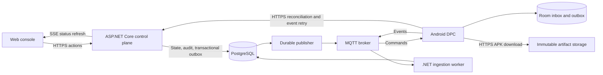

# Offline-First Android Fleet Management

Status: Implementation started. Both Android feasibility debug APKs compile and pass lint. Device Owner, genuine lock task mode, Home/Recents containment, recovery, and a locally staged agent-driven sample v1-to-v2 installation passed on API 34. Recorded regression/update runs include screenshots, MP4 replay, platform dumps, APK hashes, and build/test logs. Phase 1 remains incomplete. No benchmarks yet.

Prepared: 2026-10-16.

Current progress: a test-only Kotlin Device Owner agent, separate versioned sample app, verified Gradle wrapper, wrapper-aware prerequisite checker, and [feasibility guide](docs/android-feasibility.md) are present. The user authorized resetting the existing Pixel_8 AVD for the [runtime verification](docs/android-runtime-verification.md). Device Owner, actual LOCKED state, Home/Recents containment, recovery, four APK rejection cases, silent sample v1-to-v2 installation, and rendered v2 kiosk relaunch passed on API 34 / target SDK 34. Persisted kiosk intent restored the sample after a cold boot and retained explicit exit after another; the warm-reboot suite remains blocked by framework startup failure. The [evidence runner and saved replays](docs/test-evidence.md) preserve passing and failed attempts; the original manual provisioning was not recorded retrospectively. The lab has an unauthenticated exit and a debug local installer, not production lockdown or trusted remote release delivery. Settings restrictions, authenticated maintenance, MQTT, durable synchronization/session recovery, backend, and console remain unimplemented. Fresh-source build/lint, twenty-three runner unit tests, and sixteen update checkpoints passed; broader compatibility and remaining phase 1 gates are open.

### Implementation Snapshot

| Scope | Implemented and verified | Remaining exit criteria |
| --- | --- | --- |
| Android feasibility, phase 1 | Pinned build/lint, Device Owner provisioning, genuine kiosk containment, lab exit, recorded local v1-to-v2 update; persisted post-unlock kiosk intent verified enabled and disabled across cold boots | Warm-reboot suite blocked by framework startup; selected restrictions, messaging lifecycle, authenticated maintenance, broader runtime reliability |
| Expanded update checks | Four rejection cases passed on-device, twenty-three runner unit tests, fresh-source sixteen-checkpoint update regression and native video validation | Broader compatibility and durable remote release delivery |
| Foundation and vertical slice, phases 2-3 | Architecture and contracts planned | Enrollment/TLS/authentication, database, backend, console, end-to-end policy assignment |
| Offline resilience and trusted updates, phases 4-5 | Requirements and failure semantics planned | Room/outbox, durable reconciliation, authenticated resumable downloads, signed release metadata, installation recovery, rollout controls |
| Hardening and release, phase 6 | Local evidence capture and replay tooling | Authorization/revocation/load tests, compatibility, benchmarks, final demo and release checklist |

No phase is complete yet. The recorded local installer is a feasibility proof, not completion of the reliable remote-update subsystem. The original 8-12 week part-time target remains a planning assumption, not a measured remaining-time estimate.

## 1. Project Goal

Build a custom Android Device Policy Controller (DPC), a C# / ASP.NET Core control plane, and a lightweight web management console for dedicated devices operating on unreliable networks.

The portfolio story is an end-to-end workflow: a tablet remains in kiosk mode while offline, safely resumes an interrupted application update, and reconciles commands and telemetry after reconnecting.

Use an industry-neutral scenario with synthetic device and site data to demonstrate management of distributed fleets. Do not collect personal or sensitive operational data or imply affiliation with any organization.

### Confirmed Preferences

| Decision | Selection |
| --- | --- |
| Release goal | Portfolio MVP with a production-minded design |
| Backend | C# / ASP.NET Core |
| Initial Android hardware | Emulator only |
| Timeline | 8-12 weeks part-time |

The schedule provisionally assumes 8-12 development hours per week. That hours estimate is a planning assumption, not a confirmed commitment. All technical recommendations below remain subject to review and feasibility testing.

## 2. MVP Scope

### Device Owner and Kiosk Management

- Provision a clean emulator as a fully managed Device Owner device.
- Use genuine lock task mode, not user-exitable screen pinning.
- Launch a separate sample managed application in a single-app kiosk.
- Apply an application allowlist and selected network/application settings restrictions using public Android APIs.
- Persist the last successfully applied valid policy across disconnections and restore the intended kiosk state after reboot.
- Include authenticated maintenance access and documented recovery through emulator snapshots/reset.

### Reliable Application Updates

- Deliver a separate sample application with visibly distinguishable v1 and v2 releases.
- Receive update notifications through MQTT and discover missed work through HTTPS reconciliation.
- Download APKs over authenticated HTTPS, with resumable transfers and integrity checks.
- Verify signed release metadata, package identity, APK signer, version, compatibility, and content hash.
- Install through `PackageInstaller` as Device Owner and track actual installation outcomes.
- Support a pilot device/group followed by explicit manual promotion.

### Telemetry and Offline Synchronization

- Capture supported battery, storage, connectivity, application version, policy version, queue, and update metrics.
- Collect agent and cooperative sample-application crash summaries, not arbitrary third-party logs.
- Persist outgoing telemetry and command results in Room until application-level server acknowledgement.
- Bound local storage, prioritize command results, and expose dropped/coalesced sample counters.
- Reconcile desired and observed device state after reconnecting.

### Management Console

- Administrator and viewer roles, enforced by the backend.
- Fleet list with site/group tags, health freshness, and filters.
- Device detail with applied policy, application versions, telemetry, and command history.
- Policy assignment, release deployment, progress, error reasons, and audit history.
- A single organization in the MVP; site/group tags are not tenant isolation.

## 3. Explicit Non-Goals

Do not include AOSP builds, custom firmware OTA, root, hidden APIs, arbitrary remote shells, remote wipe, covert management, BYOD/work profiles, DPC self-updates, a multi-app launcher, production multi-tenancy, or commercial EMM certification in the MVP.

Defer managed Google Play, zero-touch enrollment, automatic certificate rotation, broker clustering, Kubernetes, Kafka, and automatic health-triggered rollback.

APK delivery is an application-update workflow, not an Android firmware OTA engine. A custom DPC using public APIs does not establish custom-ROM engineering experience or Android Enterprise certification. Google currently identifies approval constraints for custom DPC integration with its EMM services; this lab must not depend on managed Google Play approval.

## 4. Recommended Stack

| Component | Recommendation | Reason |
| --- | --- | --- |
| Android | Kotlin, Gradle Kotlin DSL, coroutines/Flow | Native platform integration and structured asynchronous work |
| Device controls | `DevicePolicyManager`, `PackageInstaller` | Public device-management and installation APIs |
| Local durability | Room | Transactional command inbox and event outbox |
| Recovery scheduling | WorkManager | Persistent, constraint-aware background reconciliation |
| HTTP | OkHttp | TLS and resumable artifact requests |
| Android messaging | HiveMQ MQTT Client | Existing MQTT implementation; validate Android/TLS compatibility first |
| Broker | Mosquitto 2.x | Small reproducible local deployment |
| Backend | C#, ASP.NET Core Web API | Modular service with built-in dependency injection, authentication, and authorization support |
| Backend messaging | MQTTnet | Existing .NET MQTT client implementation |
| Background processing | `BackgroundService` and hosted services | Outbox publishing, ingestion, and retention processing |
| Database | PostgreSQL, EF Core, Npgsql provider, EF Core migrations | Durable state, uniqueness constraints, audit and outbox records |
| Backend testing | xUnit, ASP.NET Core integration testing, Testcontainers for .NET | Unit tests and integration tests against real PostgreSQL and Mosquitto |
| Fleet simulator | C# / .NET console application with MQTTnet | Repeatable protocol, load, and reconnect testing |
| Backend observability | OpenTelemetry and structured logging | Traces, operational metrics, and correlated diagnostics |
| Console | React, TypeScript, Vite, TanStack Query | Lightweight operations interface |
| Console updates | Server-Sent Events (SSE) | One-way live refresh without another device transport |
| Local infrastructure | Docker Compose and TLS reverse proxy | Repeatable lab environment |

Use a small Compose enrollment/diagnostics UI on Android and an established accessible web component library. Start with compact JSON and measure wire bytes before adopting another encoding.

Use a supported .NET LTS release and compatible ASP.NET Core, EF Core, Npgsql, and MQTTnet versions. Pin the SDK with `global.json` and record dependency versions during foundation work. The Android agent remains Kotlin and the console remains React/TypeScript.

Proposed Android minimum: API 30. Use API 34 as an initial baseline and add a current stable image for compatibility testing. Compile/target SDK and dependency versions must be selected and pinned against the installed stable toolchain during the feasibility phase. Baseline testing alone does not establish support for every API level from 30 onward.

## 5. System Architecture

Build an ASP.NET Core modular monolith, not independent microservices. HTTP endpoints, domain logic, ingestion, and background publishing share a codebase. Start with hosted background services in the API host; separate API and worker hosts only when operational needs justify it.

Hosted services are execution mechanisms, not durable queues. Keep pending work in PostgreSQL and create a dependency-injection scope or factory-created `DbContext` per worker operation. Never share a `DbContext` across concurrent message handlers. Use explicit database transactions where multiple state changes must commit atomically.



PostgreSQL is authoritative for desired state and commands. Room is authoritative for device-local pending work and unacknowledged results. MQTT improves responsiveness; it is not the only recovery path.

The browser never receives broker/device credentials. Serve immutable artifacts with HTTP Range and ETag support locally; preserve a storage boundary for S3-compatible storage later. APK bytes never travel over MQTT.

Document emulator-to-host networking explicitly. The emulator's `localhost` is not the host running Compose.

## 6. Command and Synchronization Design

Define versioned OpenAPI and JSON Schema contracts before parallel implementation.

Command envelope fields: `schemaVersion`, `commandId`, `deviceId`, per-device sequence/version, type, payload, `issuedAt`, `expiresAt`, and `correlationId`.

Initially allow only `SET_POLICY`, `INSTALL_RELEASE`, and `REQUEST_SYNC`. Serialize conflicting work per device, define supersession rules, and prevent old policies or deployments from overwriting newer desired state.

Command lifecycle: `pending -> received -> running -> succeeded / failed`. Commands that expire before execution become `expired`. Cancellation after work starts requires operation-specific behavior; an expired deadline does not undo a committed installation.

### Delivery Rules

1. Commit command creation, audit entry, and publish-outbox entry in one PostgreSQL transaction.
2. Persist received commands in Room before acknowledging receipt to the control plane.
3. Return stored progress/results for duplicate command IDs.
4. Persist device results before sending them; delete only after server application acknowledgement of durable ingestion.
5. Enforce unique event IDs in PostgreSQL so retries do not create duplicate history.
6. Inspect actual Android policy/package/session state after a crash before repeating external side effects.

Use at-least-once delivery with idempotent effects. MQTT PUBACK is not command success or proof that an event reached PostgreSQL. Ensure either suitable subscriber acknowledgement control or application retries close the ingestion loss window.

Keep both device `recordedAt` and server `receivedAt`; define clock-skew and expiry behavior. Use monotonic time for local retry durations where possible.

Suggested topics: `devices/{deviceId}/commands`, `devices/{deviceId}/events`, and `devices/{deviceId}/acks`. Devices may subscribe only to their commands/acks and publish only their events. Use bounded broker session lifetimes and do not retain imperative commands. Presence/last-will messages are hints; derive freshness from persisted reports and expected cadence.

### Android Runtime Constraints

WorkManager periodic work has a 15-minute minimum and is inexact under power-management restrictions. It is not an immediate push mechanism.

Validate MQTT behavior while the separate managed kiosk app is foreground during week one. Device Owner status does not imply unrestricted execution. Use supported lifecycle/background behavior and durable HTTPS recovery; do not assume an immortal socket or a permanently running foreground service. If a service is needed, validate its permitted type, start rules, notification, timeouts, reboot behavior, and target-SDK restrictions.

Default reconciliation and health cadence: approximately 15 minutes when scheduling permits, plus reconnect/error-triggered work. Use exponential backoff with full jitter and bounded batches. Screen-off commands may wait for reconciliation. A 30-60 second active demo cadence must be labeled nonproduction and must not be implemented as sub-15-minute periodic WorkManager scheduling.

Bound the Room telemetry spool by bytes and age. Preserve command results preferentially; coalesce/drop ordinary samples first, report drop counts, and handle full disk explicitly.

## 7. Security and Enrollment

OS Device Owner provisioning and backend enrollment are separate steps. Use only authorized, fully managed lab devices with transparent diagnostics and recovery.

Recommended enrollment:

1. An administrator creates a short-lived, one-use token bound to a pending enrollment.
2. The agent generates a private key in Android Keystore and submits a CSR over server-authenticated TLS using the token.
3. The backend assigns an immutable device ID and issues a device certificate.
4. Subsequent device HTTPS/MQTT traffic uses mTLS, with authorization bound to the authenticated identity.

Keep CA and signing private keys out of Git. Document trust bootstrap and use scoped Android lab-CA trust configuration, never permissive certificate validation. Define credential expiry, re-enrollment, and key-loss handling. Revocation must reject new HTTPS/MQTT access and terminate existing broker sessions; a documented broker reload/restart is acceptable for the lab.

Use a maintained OIDC provider for console authentication, backend-validated sessions, secure HttpOnly cookies, CSRF protection for mutation routes, and server-side administrator/viewer authorization. Exact provider selection remains open; do not invent a password or token protocol.

Audit privileged actions, apply rate/payload limits, and keep credentials out of logs. Audit records are append-only at the application layer, not claimed to be tamper-proof. Cover replay, compromised broker, unauthorized administrator/device, stale commands, artifact tampering, revoked identity, and network partitions in the threat model.

## 8. Signed Application Delivery

Publish an immutable APK and a detached signature over exact release-manifest bytes. Select a vetted signing implementation compatible with Android and .NET; fix the algorithm and serialization contract before implementation.

Manifest fields include release ID, package name, version code, SHA-256 hash, byte length, minimum SDK, permitted APK signer identity, expiry, and artifact object identity.

The agent verifies manifest trust, expiry, artifact length/hash, actual APK package/version/signer, and platform compatibility. Android independently validates APK signatures. Restrict artifact schemes, hosts, and redirects; do not accept arbitrary operator-supplied URLs.

Persist partial-download offset and ETag. Use Range/If-Range and validate `206` Content-Range responses. Restart safely when content changes or a server ignores Range. Apply battery, storage, and connectivity constraints, with bounded retries.

Persist installation session IDs and reconcile missing callbacks after process death/reboot. Explicitly handle `STATUS_PENDING_USER_ACTION`, blocked installations, and unsupported behavior. Deployment success requires observed installed version and cooperative sample-app health acknowledgement, not just command receipt.

Silent installation means no required user confirmation on the validated managed configuration, not zero visible application interruption. Pause stops unsent deployment work; it cannot necessarily cancel an installation already committed to Android.

Rollback means halt promotion and ship previous behavior with a higher version code. Do not promise arbitrary APK downgrades or automatic DPC self-recovery in the MVP.

## 9. Telemetry and Analytics

Capture battery level/charging/temperature where available, free/total storage, network transport/connectivity, installed agent/managed-app versions, applied policy, queue/drop counters, update progress, and supported crash summaries.

Wi-Fi/cellular signal depends on permissions and capabilities. Record unavailable readings as null with a reason, not zero. Emulator radio/temperature data is simulated or unavailable and must be labeled accordingly. Use agent process-exit information and cooperative sample-app reporting, not unrestricted system log access.

Ingest versioned events with unique IDs. Maintain latest device health and small time-window/site aggregates alongside bounded raw history; proposed raw retention is seven days. Show stale/unknown freshness, low storage, update failures, and lightweight histories. This is near-real-time ingestion and aggregation, not proof of a large streaming analytics platform.

Operational metrics should include ingestion latency/errors, command-stage latency, outbox age, reconnects, queue depth, update outcomes, database growth, and wire bytes. Prometheus-format metrics and structured logs are sufficient initially; Grafana is optional.

## 10. Roadmap and Exit Gates

| Phase | Timing | Deliverables and acceptance gate |
| --- | --- | --- |
| 1. Android feasibility | Week 1 | Pin toolchains; prove Device Owner, actual lock task state, selected restrictions, sample v1-to-v2 silent update, reboot recovery, messaging lifecycle, and maintenance access. Record evidence before expanding scope. |
| 2. Foundation | Week 2 | Versioned contracts, migrations, TLS bootstrap/enrollment, authentication, Compose, CI foundation, and sample app. Depends on phase 1. |
| 3. First vertical slice | Weeks 3-4 | Console assigns a policy, agent applies it, backend records observed state, and UI refreshes after reconnect. Android and ASP.NET Core work may run in parallel once contracts are agreed. |
| 4. Offline resilience | Weeks 5-6 | Bounded telemetry spool, durable acknowledgements/deduplication, jittered reconnect, freshness/aggregates, retention, and process/broker failure tests. Depends on phase 3. |
| 5. Verified updates | Weeks 7-8 | Signed releases, authenticated resumable delivery, installation recovery, pilot deployment/promotion, and negative integrity tests. Depends on phase 3; can partly overlap phase 4. |
| 6. Hardening and evidence | Weeks 9-10 | Authorization/revocation tests, load simulator, failure demos, responsive UI checks, repeatable startup, and benchmark report. Depends on phases 4 and 5. |
| Buffer and presentation | Weeks 11-12 | Resolve compatibility issues, record demo, document limitations, and prepare an MVP release. No required additional features. |

If the schedule slips, reduce dashboards, multi-site rollout ergonomics, optional Grafana, and visual polish first. Preserve Device Owner proof, durable reconciliation, update integrity, authorization boundaries, and failure tests.

## 11. Proposed Repository Layout

The following layout is the target structure. The Android feasibility modules and setup documentation now exist; backend, console, contracts, infrastructure, simulator, and CI remain proposals:

```text
android/
  agent/                 DPC, policy adapter, Room, reconciliation, updates
  sample-managed-app/    Separate v1/v2 kiosk app and cooperative health reporting
backend/
  src/FleetManagement/   ASP.NET Core host, feature modules, hosted workers,
                         EF Core persistence, and migrations
  tests/                 xUnit unit and integration test projects
console/                 React management interface
contracts/
  openapi.yaml           HTTP contracts
  events/                Versioned message/manifest schemas and golden fixtures
infra/                   Compose, broker ACLs, TLS proxy, local trust tooling
tools/fleet-simulator/   .NET console app with MQTTnet and fault/load profiles
docs/                    Architecture, threat model, capability matrix, demo,
                         benchmarks, verification, and architecture decisions
.github/workflows/       CI after runnable components exist
```

Proposed Android boundaries: `DevicePolicyController`, `CommandProcessor`, `ReconcileWorker`, and `ApkUpdateManager`. Keep Android framework calls behind testable adapters without creating unnecessary abstraction layers.

Proposed backend operations: `EnrollDevice`, `AssignPolicy`, `CreateDeployment`, `ReconcileDevice`, and `IngestDeviceEvents`.

Proposed tables: devices, enrollment tokens, policies, assignments, commands, command events, releases, deployments, telemetry events, latest health, aggregates, audit events, and outbox. Add uniqueness/state constraints, ingestion indexes, and a retention job.

## 12. Verification Plan

### Feasibility and Android Behavior

- Provision a clean emulator without accounts using the documented `adb shell dpm set-device-owner <package>/<receiver>` lab flow. Confirm prerequisites, manifest receiver declarations, and recovery before applying restrictions.
- Assert Device Owner status and `ActivityManager.LOCK_TASK_MODE_LOCKED`; test Home/Recents/settings restrictions, offline persistence, and reboot restoration.
- Verify maintenance access and real sample-app installation without a confirmation dialog.
- Test baseline and current stable emulator images and record exact SDK/target/dependency versions. Emulator evidence does not prove OEM, radio, battery, or physical tamper behavior.

### Automated Checks Once Components Exist

- .NET build and xUnit tests via `dotnet build` and `dotnet test`, ASP.NET Core endpoint tests with `WebApplicationFactory`, and real PostgreSQL/Mosquitto integration tests using Testcontainers for .NET. Include concurrent-handler and outbox crash-recovery tests; .NET does not provide Go-style race detection.
- Android unit tests, lint, and instrumentation tests against a deliberately provisioned Device Owner emulator.
- Console type checks, tests, production build, and Playwright role/workflow tests.
- Shared golden fixtures for command/event/manifest acceptance and rejection across languages.
- CI must document Device Owner setup and runner capabilities. Heavy fleet benchmarks can be manual rather than per pull request.

### Failure and Security Scenarios

- Crash between database commit and publication; duplicate/out-of-order messages; lost application acknowledgements; broker restart; stale/expired commands; clock skew.
- At least 30 minutes offline, process/emulator restart, reconnect, bounded queue replay, and no duplicate persisted event IDs. Overflow must produce documented drops rather than an unlimited queue.
- Doze testing with honest reporting of deferred execution; newer desired state must not be replaced by stale replay.
- Interrupted downloads, changed ETags, ignored Range, corrupt APKs, wrong signer/package/version, expired metadata, low storage/battery, lost install callbacks, and reboot during installation.
- Token reuse/expiry, cross-device REST/topic access, viewer mutation attempts, revoked credentials, and existing-session revocation.
- Playwright checks for fleet/device/policy/deployment/audit workflows, SSE reconnect/refetch, and desktop/mobile layout without overlapping content.

### Network and Scale Evidence

Use emulator network controls or an explicitly configured proxy to affect actual device traffic. Use Toxiproxy where appropriate for backend TCP paths; a Compose proxy does not automatically shape emulator traffic. Demonstrate approximately 128 kbit/s throughput, 800 ms round-trip latency, interrupted downloads, and outages with the precise setup recorded.

Start with 100 simulated devices; stretch to 1,000 concurrent clients if local hardware permits. Separate normal 15-minute health cadence from synthetic burst/reconnect stress profiles. Record host hardware, CPU/RAM, TLS settings, workload, wire bytes, database growth, errors, and p50/p95 latency.

Provisional targets, not measured claims:

- p95 command receipt acknowledgement within five seconds for actively connected/executing devices on a healthy unconstrained local network; this is not completion latency or a background-delivery guarantee.
- Routine non-crash health event envelope at most 1 KiB, excluding transport overhead.
- No duplicate persisted event IDs in fault tests, bounded queues, and eventual desired-state convergence when execution/connectivity permit.

Simulation validates protocols/backend behavior, not Android execution or production fleet capacity. Defer 10,000-device claims and clustered broker tests until supported by reproducible measurements.

## 13. Risks and Review Decisions

| Risk or unresolved choice | Planned response |
| --- | --- |
| Agent lifecycle while separate kiosk app is visible | Test in week one; select a supported connection strategy and retain HTTPS reconciliation. |
| Silent installs vary with platform/target behavior | Publish tested capability matrix and report user-action/blocked states explicitly. |
| Emulator-only access | Label simulated metrics and defer physical-device/OEM claims. |
| Security foundation consumes the schedule | Use maintained identity components; reduce optional presentation features first. |
| Offline backlog and reconnect storms | Byte/age limits, priority queues, jitter, batches, durable ingestion, and repeatable load profiles. |
| Signing algorithm, OIDC provider, exact library versions | Select after compatibility spikes and record decisions before implementation. |
| Certificate expiration or key loss | Document re-enrollment/recovery; defer automatic rotation, not expiry handling. |
| Part-time availability differs from assumption | Re-estimate after feasibility; preserve the smallest complete reliable workflow. |

Review before implementation: MVP exclusions, phase-one gate, proposed API support, identity/signing approach, and acceptable screen-off command delay.

## 14. Portfolio Deliverables

- Concise README with honest planned/implemented status, setup, demo, and known limitations.
- Architecture and trust-boundary diagrams plus an Android capability matrix.
- Four to six architecture decisions covering DPC versus AOSP, MQTT plus HTTPS, idempotent delivery, bounded offline storage, release trust, and the ASP.NET Core modular monolith.
- A three-to-five-minute failure-and-recovery demonstration, not only happy-path screenshots.
- Reproducible test and benchmark reports; CI badges only after real successful runs.
- A tagged MVP when its acceptance gates pass. Any hosted public console should be read-only and synthetic, without privileged device control.

## 15. Primary References

- [Android lock task mode](https://developer.android.com/work/dpc/dedicated-devices/lock-task-mode)
- [PackageInstaller API](https://developer.android.com/reference/android/content/pm/PackageInstaller)
- [Build a device policy controller and approval constraints](https://developer.android.com/work/dpc/build-dpc)
- [WorkManager periodic work](https://developer.android.com/develop/background-work/background-tasks/persistent/getting-started/define-work#periodic-work)
- [Android power-management resource limits](https://developer.android.com/topic/performance/power/power-details)
- [Foreground services](https://developer.android.com/develop/background-work/services/fgs)

Recheck current platform documentation during implementation. This plan records a proposed design, not verified platform behavior on the eventual supported device matrix.