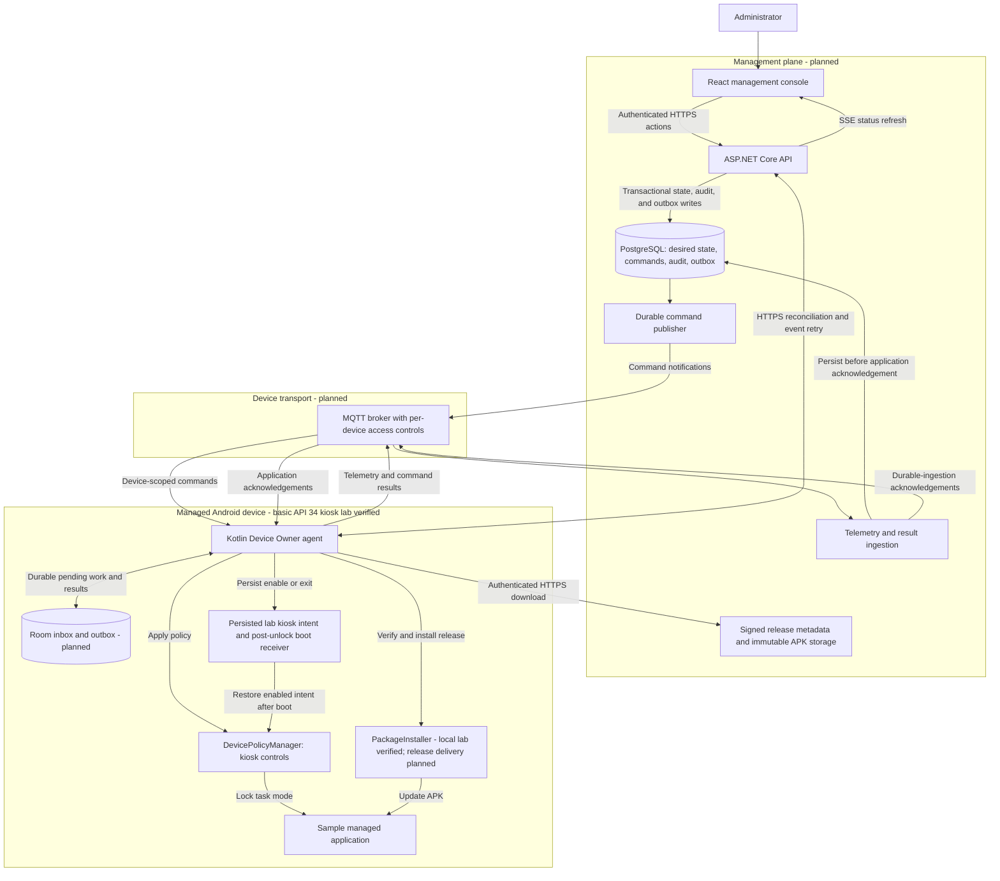

# Offline-First Android Fleet Management

A Kotlin Android Device Policy Controller with a planned C# / ASP.NET Core control plane and React management console for intermittently connected device fleets.

## Status

Implementation has started with a minimal Android feasibility lab: a test-only Device Owner agent, a separate versioned sample app, and a prerequisite checker. Both debug APKs compile and pass Android lint with the checksum-pinned Gradle 8.9 wrapper. Device Owner provisioning, genuine lock task mode, Home/Recents containment, and visible lab recovery passed on a reset API 34 emulator. See the [runtime verification record](docs/android-runtime-verification.md) for evidence and limits.

The lab has a visible kiosk exit path and is not suitable for production device lockdown. A locally staged, agent-driven sample v1-to-v2 PackageInstaller update is verified on API 34, including negative identity/version/signer/invalid-APK checks and v2 kiosk relaunch. The [latest sixteen-checkpoint replay](artifacts/android/20261016T094840.126613Z-update/replay.html) passed with fresh builds/lint, regenerated fixtures, twenty-three unit tests, and native video validation. Persisted kiosk intent restored the sample automatically after a non-wiping cold boot, while an explicit exit remained disabled after another cold boot. The automated warm-reboot suite was blocked by Android framework startup failure, not relabeled as passing. [Recorded tests](docs/test-evidence.md) retain screenshots, video replays, platform dumps, and source build/test logs, including failures and recovery. Signed release delivery, MQTT, durable synchronization, backend services, and the web console are not implemented yet.

## Architecture

This diagram shows the target end-to-end architecture, not a deployed system. Only the agent and sample-app feasibility modules exist today; their build and basic Device Owner/kiosk/recovery workflow are verified on one API 34 emulator. Every other component and integration shown below is planned.



### End-to-End Flow

1. An administrator assigns a policy or deployment through the console. The API commits desired state, audit history, and a publish-outbox record in one PostgreSQL transaction.
2. A durable publisher notifies the agent through MQTT. The agent persists the command in Room before acknowledging receipt, then applies supported Android controls or performs the verified update workflow.
3. APKs travel over authenticated HTTPS, not MQTT. The agent verifies signed metadata and APK identity/integrity before installation; observed version and application health determine deployment success.
4. Telemetry and execution results remain in the device outbox until the backend acknowledges durable ingestion. Retries use event IDs and idempotent processing to avoid duplicate history.
5. After missed messages or network loss, HTTPS reconciliation restores convergence with desired state. The console refreshes from backend state through SSE; broker delivery alone never means a command succeeded.

### Boundaries and Reliability

- PostgreSQL owns fleet desired state and durable backend work; Room owns device-local pending work and unacknowledged results.
- The target design uses device mTLS identities and per-device broker permissions. Console authentication and authorization are separate; the browser receives no device or broker credentials.
- Device Owner provisioning is separate from backend enrollment. Only authorized disposable lab devices should be provisioned during feasibility work.
- Android scheduling and power restrictions still apply. MQTT improves responsiveness but does not guarantee continuous background execution; HTTPS recovery is deliberately part of the design.

## Documentation Standard

Documentation is part of the implementation deliverable, not a final cleanup task. Changes to behavior, interfaces, setup, security, or deployment must update the relevant documentation in the same change. Keep this architecture diagram and end-to-end flow aligned with the code, label planned versus verified capabilities, and record validation results and known limitations without overstating them.

## Start Here

- [Project plan](PROJECT_PLAN.md): scope, stack, roadmap, and acceptance gates.
- [Android feasibility lab](docs/android-feasibility.md): prerequisites, build, disposable emulator provisioning, recovery, and remaining gates.
- [Recorded tests](docs/test-evidence.md): screenshot/video replays, captured passing and failed runs, and repeatable commands.

```sh
sh tools/doctor.sh
```

No device is provisioned, reset, or modified by the prerequisite checker.
