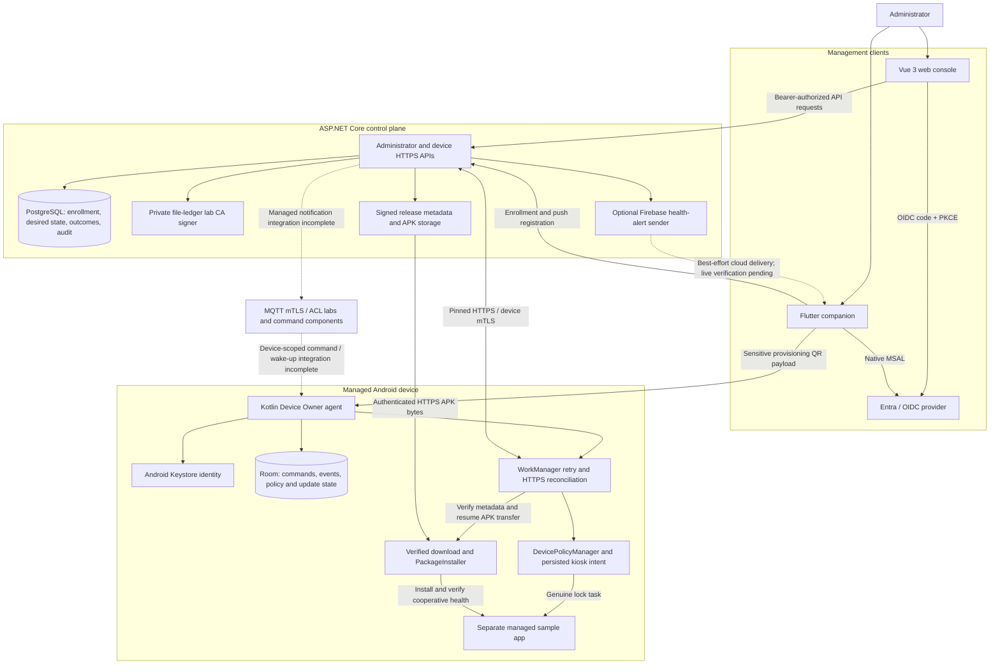

# Offline-First Android Fleet Management

A custom Android Device Policy Controller (DPC), ASP.NET Core control plane, Vue management console, and Flutter administrator companion for dedicated devices on unreliable networks.

The goal is an end-to-end fleet workflow: keep a device in genuine kiosk mode while offline, safely resume an interrupted application update, and reconcile policy, installation outcomes, and queued events after reconnecting.

## Current Status

The repository has progressed beyond the initial Android feasibility lab. It now contains a running API host, PostgreSQL persistence, Android enrollment and durable event delivery, HTTPS policy and signed-release reconciliation, a Vue 3 console, and a Flutter companion with Entra sign-in, QR enrollment, and Firebase push integration.

**This is an actively developed portfolio MVP, not a production-ready MDM platform or a fully accepted end-to-end system.** The latest documented acceptance checkpoint is **2026-10-21**. Component tests and isolated API 34 runtime scenarios pass, but the combined console/backend/device offline-reboot-reconnect demonstration, live identity-provider/cloud verification, and current-stable Android hardening remain open.

| Area | Implemented | Verification boundary / remaining work |
| --- | --- | --- |
| Device Owner and kiosk | Kotlin DPC, separate sample app, genuine lock task, selected settings restrictions, persisted kiosk intent, boot restoration, signed maintenance exit | API 34 emulator evidence; physical-device/OEM reliability and current-stable compatibility are not established |
| Enrollment and identity | Bootstrap-token/CSR enrollment, PostgreSQL claim/completion recovery, lab CA signer, Android Keystore identity, pinned HTTPS and device mTLS | Combined API 34/Kestrel/PostgreSQL lab verified; production CA, renewal/rotation and complete revocation remain open |
| Durable events | Strict shared contracts, Room command inbox/event outbox, bounded WorkManager retry, durable backend ingestion and exact acknowledgement before local deletion | Process/reboot recovery checks have explicit lab limits; they do not prove autonomous delivery in every OS lifecycle state |
| Policy reconciliation | Authenticated device-bound HTTPS retrieval, Room persistence before effects, kiosk enforcement and applied-version acknowledgement | Supported policy is intentionally limited to kiosk enable/disable; combined console/backend/device acceptance remains open |
| Application updates | Signed metadata, pinned-mTLS resumable APK transfer, integrity/identity checks, persisted PackageInstaller state and authenticated outcomes | API 34 mock-server test verifies silent v1-to-v2 install, resume, health and lost-ack replay; actual-backend/device and install process-death/reboot acceptance remain open |
| Control plane | ASP.NET Core API, EF Core/Npgsql persistence, administrator authorization, policy/release workflows, telemetry and health-alert components | Endpoint and database tests are not proof of complete console/API compatibility or production deployment |
| Web console | Vue 3/TypeScript UI, OIDC authorization code + PKCE, server-authorized viewer/admin sessions, policy management, signed-release import and deployment outcomes, compliance reports | Some historical device/tag/settings actions still target unavailable endpoints and fail visibly; no simulated success or real-time fallback |
| Mobile companion | Flutter app, native MSAL Entra sign-in/session handling, QR provisioning payloads, FCM registration and generic health alerts | Local analysis/tests and iOS simulator build recorded; native app responsiveness, live Entra, Firebase/APNs and QR provisioning end-to-end remain unverified |
| MQTT | TLS diagnostics, device mTLS/ACL labs and command/publication components | Managed wake-up integration is incomplete; the legacy Android MQTT `INSTALL_RELEASE` branch is not implemented |

See the [project acceptance checkpoint](PROJECT_PLAN.md#resumed-implementation-checkpoint-2026-10-21) for remaining MVP gates and [recorded test evidence](docs/test-evidence.md) for passing runs, retained failures, exact inputs and limitations. Historical phase-completion summaries are not acceptance of the entire MVP.

## Technology Stack

| Component | Stack |
| --- | --- |
| Android agent and managed sample | Kotlin, Android DevicePolicyManager, Room, WorkManager, PackageInstaller, HiveMQ MQTT client |
| Backend | C# / ASP.NET Core on .NET 10, EF Core, Npgsql, PostgreSQL |
| Management console | Vue 3, TypeScript, Vite, Pinia, Tailwind CSS, Chart.js, `oidc-client-ts` |
| Administrator companion | Flutter/Dart, native MSAL (`msal_auth`), Firebase Cloud Messaging |
| Contracts and verification | JSON Schema, OpenAPI 3.1, Python evidence runners, .NET/JVM/Android/browser-component tests |

The Android agent currently targets/compiles against API 34 with minimum API 30. API 34 is the recorded runtime baseline, not a claim that every Android version from API 30 onward has been tested. The backend SDK is pinned in [global.json](backend/global.json).

## Architecture

Solid arrows show implemented interfaces or local workflows, not acceptance of every combined path. Dashed arrows identify incomplete or optional integration.



### Reliability and Security Boundaries

- **Desired state is not observed success.** Policy assignment, command publication and deployment targeting do not prove enforcement or installation. The agent reports validated outcomes through authenticated interfaces.
- **Persist before acknowledging.** Room retains pending device work; PostgreSQL commits accepted events and their original acknowledgements. The agent removes an outbox event only after validating the exact matching reply.
- **HTTPS recovers missed work.** Policy and desired-release reconciliation use the enrolled identity, bounded requests and retry. MQTT is not an always-on execution guarantee.
- **APKs do not travel over MQTT.** Release metadata signatures, content hash, package identity, APK signer, version and compatibility are independently checked before installation.
- **Administrator and device identities are separate.** Console/companion access uses OIDC bearer authorization; device APIs use enrolled mTLS identities. Neither credential grants the other's privileges.
- **The CA is a lab implementation.** The file ledger prevents blind reissuance after uncertainty within its documented boundary; it is not a production PKI or power-loss-safe signing service.
- **Maintenance is authenticated.** Per-device P-256 ECDSA proofs authorize local kiosk exit. Debug/ADB pairing is trusted-lab-only; lost operator keys require authorized lab recovery, not an unauthenticated UI bypass.

## Repository Layout

| Path | Purpose |
| --- | --- |
| [android/](android/) | Device Owner agent, sample managed app, Gradle wrapper and Android tests |
| [backend/](backend/) | API host, domain/persistence services, migrations, .NET tests and HTTP examples |
| [frontend/console/](frontend/console/) | Vue management console and component/service tests |
| [mobile/companion/](mobile/companion/) | Flutter administrator app and platform configuration |
| [contracts/](contracts/) | Versioned wire schemas, OpenAPI and shared acceptance/rejection fixtures |
| [tools/](tools/) | Prerequisite checker, lab hosts and repeatable evidence runners |
| [docs/](docs/) | Setup runbooks, behavior/verification boundaries and acceptance records |
| [artifacts/](artifacts/) | Recorded replays, manifests and test evidence; historical failures are retained |

## Getting Started

There is no one-command production deployment. Start with the component you need and follow its trust/configuration runbook before connecting devices or exposing services.

### 1. Android lab

Prerequisites: JDK 17, Android SDK platform/build tools 34, platform-tools, and an explicitly authorized disposable API 34 emulator. The repository includes the checksum-pinned Gradle wrapper.

From the repository root:

```sh
sh tools/doctor.sh
```

The checker does not provision, reset or modify a device. Build the agent and sample:

```sh
cd android
./gradlew :agent:assembleDebug :sample-managed-app:assembleDebug \
  :agent:lintDebug :sample-managed-app:lintDebug
```

Follow the [Android feasibility runbook](docs/android-feasibility.md) for Device Owner provisioning and recovery, and [Android enrollment](docs/android-enrollment.md) for Keystore/backend enrollment. **Do not provision or reset a personal or shared device.** The default agent is test-only; Android Enterprise QR provisioning requires a separately signed, non-testOnly APK as described in the [companion QR setup](mobile/companion/README.md#qr-device-enrollment).

### 2. Backend

Install the exact .NET SDK from [backend/global.json](backend/global.json). For database-backed workflows, use an authorized PostgreSQL instance with the repository migrations applied.

```sh
cd backend
dotnet build FleetManagement.slnx
dotnet run --project src/FleetManagement.Api/FleetManagement.Api.csproj --no-launch-profile
```

The run command starts the host; it does **not** provision a usable fleet environment. Configure Kestrel HTTPS and the following boundaries first:

- [Enrollment HTTP configuration](docs/enrollment-http.md#configuration): database connection, digest key, lab CA certificate/private key and private signer ledger.
- [Administrator authorization](docs/administrator-enrollment.md): trusted OIDC authority, dedicated API audience, and the Generic or Entra token profile.
- [Device mTLS](docs/device-mtls.md): client-certificate trust, enrolled identity membership and access-disable behavior.
- [Signed release publishing](docs/PHASE2-PLAN.md#signed-https-release-lab): trusted metadata public key and hosted APK artifacts.
- [PostgreSQL lab](docs/postgres-lab.md): isolated local database verification and its limits.

The host rejects cleartext requests, does not automatically apply migrations, and does not generate operator credentials or CA secrets. Missing enrollment configuration leaves enrollment unavailable; partial configuration fails startup. Keep connection strings, private keys, digest keys, bootstrap tokens and Firebase service-account files outside Git.

### 3. Web console

Use Node.js/npm; the latest documented local build used Node 22. Configure the public OIDC/API values using [the console setup guide](frontend/console/README.md#real-identity-provider-setup) and [.env.example](frontend/console/.env.example). A browser SPA registration and a server-authorized viewer/administrator are required; there is no bundled mock login.

```sh
cd frontend/console
npm ci
npm run dev
```

Configure the exact callback origins, API TLS trust, delegated scopes/app roles, and either the same-origin proxy or backend CORS origin. Leave the optional SignalR URL unset until a compatible authenticated backend hub exists. API/provider failures remain visible rather than falling back to fabricated fleet data.

For signed APK imports, explicit enrollment targeting and confirmed manual promotion, follow the [signed release console workflow](frontend/console/README.md#signed-release-workflow). A staged percentage is metadata, not automatic fleet selection.

### 4. Mobile companion

Use Flutter and follow the [companion setup guide](mobile/companion/README.md) for separate API/mobile Entra registrations, Android signature hashes and iOS signing/keychain requirements.

```sh
cd mobile/companion
flutter pub get
# After setting the Entra and API environment values from the setup guide:
tool/flutter_entra.sh run
```

Firebase/APNs and QR enrollment require additional configuration. A provisioning QR contains a live bootstrap secret: display it only to the intended operator/device and never include it in screenshots, logs or retained evidence.

## Verification

These are repeatable entry points, not claims that every suite was rerun for this README update.

| Scope | Command / runbook |
| --- | --- |
| Shared contracts | From the root: `python3 tools/check_contracts.py` after installing [contract validator requirements](tools/contracts-requirements.txt) |
| Backend components | From the root: `python3 tools/check_backend.py`; uses the pinned backend SDK and retains evidence |
| Real PostgreSQL | Follow [database setup and checks](docs/postgres-lab.md); isolated schemas and actual restart checks have explicit limits |
| Android JVM | From `android`: `./gradlew :agent:testDebugUnitTest` |
| Android runtime | Follow [recorded tests](docs/test-evidence.md) with an explicitly authorized emulator; build/JVM checks are not Device Owner runtime acceptance |
| Console | From `frontend/console`: `npm run build` and `npm test -- --run --threads=false` |
| Companion | From `mobile/companion`: `flutter analyze` and `flutter test` |
| CI coverage | [Foundation workflow](.github/workflows/foundation.yml) and [CI scope](docs/foundation-ci.md) |

The 2026-10-21 checkpoint records focused backend and console regressions, 19 real PostgreSQL tests, API 34 policy/event/update scenarios, Flutter analysis with 24 companion tests, and an iOS simulator build. These checks were performed at different slice boundaries, not as one complete fleet acceptance run. See the [project checkpoint](PROJECT_PLAN.md#resumed-implementation-checkpoint-2026-10-21), [release checkpoint](docs/PHASE2-PLAN.md#current-acceptance-checkpoint-2026-10-21) and [companion verification limits](mobile/companion/README.md#local-verification-2026-10-21).

### Remaining Acceptance Gates

- Demonstrate the actual console, backend and enrolled device together through offline policy/update work, reboot, reconnect and observed outcomes.
- Complete managed MQTT notification integration and verify missed-message recovery without assuming an immortal Android connection.
- Verify installation recovery across process death/reboot and retain failure-scenario evidence.
- Finish console/API compatibility for remaining historical fleet-management screens and verify live OIDC login.
- Verify native companion runtime behavior, real Entra sign-in, Firebase/APNs delivery and full QR provisioning.
- Complete current-stable Android testing and physical-device/OEM hardening. The recorded API 37 attempt is **not a pass**; its provisioning/recovery/media failures remain in [test evidence](docs/test-evidence.md#android-17-current-stable-compatibility-attempt).
- Address production CA/key lifecycle, audited recovery, complete revocation, deployment/operations and power-loss guarantees before making production-readiness claims.

## Documentation Map

- [Project plan and acceptance gates](PROJECT_PLAN.md)
- [Phase 1 accepted scope](docs/phase-one-acceptance.md)
- [Phase 2 implementation and signed-release runbook](docs/PHASE2-PLAN.md)
- [Policy schema, enforcement and reconciliation](docs/android-policy-handler.md)
- [Room command/event journal](docs/android-command-journal.md) and [bounded event worker](docs/android-event-worker.md)
- [Device MQTT lab and integration limits](docs/android-mqtt-enrollment.md)
- [Contracts and OpenAPI](contracts/README.md)
- [Backend enrollment/signing internals](backend/README.md)
- [Console setup and workflow limits](frontend/console/README.md)
- [Companion Entra, push and QR setup](mobile/companion/README.md)
- [Recorded passing and failed tests](docs/test-evidence.md)

Some detailed documents retain chronological descriptions of earlier milestones; read their latest checkpoint and verification-boundary notes before interpreting older "planned" or "complete" statements.

Documentation is part of each implementation change. Keep this overview, component setup instructions and verification limits aligned with behavior; do not treat an implementation checklist, build, assignment or broker delivery as proof of end-to-end success.
