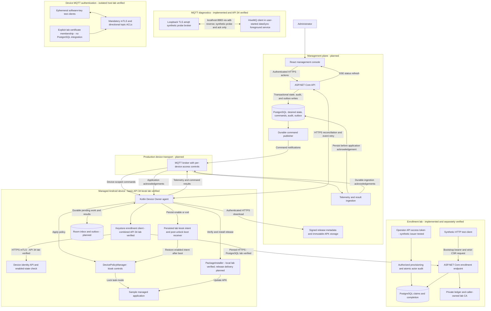

# Offline-First Android Fleet Management

A Kotlin Android Device Policy Controller with a C# / ASP.NET Core enrollment lab and a planned fleet control plane and React management console for intermittently connected device fleets.

## Status

Implementation has started with a minimal Android feasibility lab: a test-only Device Owner agent, a separate versioned sample app, and a prerequisite checker. Both debug APKs compile and pass Android lint with the checksum-pinned Gradle 8.9 wrapper. Device Owner provisioning, genuine lock task mode, Home/Recents containment, and visible lab recovery passed on a reset API 34 emulator. See the [runtime verification record](docs/android-runtime-verification.md) for evidence and limits.

Phase 1 is accepted for API 34 development feasibility under the [revised acceptance scope](docs/phase-one-acceptance.md); Phase 2 foundation work may proceed. Current-stable compatibility is deferred to hardening and remains required before broader support or production-readiness claims. Selected settings restrictions and per-device P-256 ECDSA signed maintenance exit are implemented; no unauthenticated UI exit remains. Debug/ADB pairing is still trusted lab only, not production maintenance; preserve the paired operator key securely, since key loss requires authorized trusted-emulator ADB reprovisioning, not a UI bypass. The [latest five-checkpoint maintenance replay](artifacts/android/20261016T110746.710228Z-phase-one/replay.html) and [manifest](artifacts/android/20261016T110746.710228Z-phase-one/manifest.json) passed restriction application/cleanup and unsigned, tampered, and consumed-challenge rejection, plus build/lint and native video validation. Eight JVM MaintenanceProof tests and thirty-one Python tests passed, including four new operator-pairing regression tests. The [seven-checkpoint MQTT lifecycle replay](artifacts/android/20261016T104119.390614Z-mqtt-lifecycle/replay.html) and [manifest](artifacts/android/20261016T104119.390614Z-mqtt-lifecycle/manifest.json) verify TLS roundtrip, receive/ack while the sample was foreground and LOCKED, broker-offline containment, reconnect with a fresh ACK, process-death containment without an immortal socket, explicit restart, and explicit stop. This is a test-only, user-started `START_NOT_STICKY` foreground diagnostic using anonymous synthetic probes over loopback aMQTT TLS, not production transport.

A locally staged, agent-driven sample v1-to-v2 PackageInstaller update is verified on API 34, including negative identity/version/signer/invalid-APK checks and v2 kiosk relaunch. The [fresh sixteen-checkpoint update replay](artifacts/android/20261016T104623.288748Z-update/replay.html) and [manifest](artifacts/android/20261016T104623.288748Z-update/manifest.json) passed current build/lint invocations, twenty-seven Python tests, restrictions, and signed maintenance recovery. Persisted kiosk intent restored enabled and disabled state across non-wiping cold boots; the [six-checkpoint warm-reboot replay](artifacts/android/20261016T104301.613674Z-reboot/replay.html) and [manifest](artifacts/android/20261016T104301.613674Z-reboot/manifest.json) now verify two genuine warm reboots, automatic enabled restoration/Home containment, then disabled no-restoration/persisted exit. All four new bundles passed native video validation. The [earlier warm-reboot failure](artifacts/android/20261016T093407.811439Z-reboot/replay.html) remains failed; [recorded tests](docs/test-evidence.md) preserve it and other failures. These API 34 results do not establish physical-device/OEM reliability or current-stable compatibility. Production MQTT transport, signed release delivery, durable synchronization, backend services, and the web console remain planned.

### Phase 2 Contract Foundation

The separate [device MQTT authentication lab](docs/mqtt-device-lab.md) now verifies mandatory mTLS, exact enabled certificate membership and directional per-device topic ACLs over real loopback MQTT. Thirteen host-side tests pass, including cross-device/wildcard denial, forged-client-ID isolation, live disable checks and retained suppression. Its trusted local membership file and ephemeral software-key tests are not yet connected to enrolled Android Keystore identities or PostgreSQL; production transport and lifecycle work remain open. The original anonymous Android probe diagnostic is unchanged.

The [HTTPS mTLS identity lab](docs/device-mtls.md) now authenticates Android using its enrolled Keystore key, exact completed certificate and current PostgreSQL enabled state. API 34 instrumentation passed a real mTLS request and rejection after persisted disable. A fifth migration is required. Earlier paragraphs about unverified mTLS describe prior milestones: HTTPS identity is now scoped lab-verified; MQTT mTLS, full revocation, secure production provisioning and the fleet workflow remain open.

The [Android enrollment client](docs/android-enrollment.md) prepares a non-exportable P-256 Keystore identity, reuses its exact CSR for retries, and validates pinned HTTPS/certificate responses before installation. A [combined API 34 run](artifacts/android-backend/20261017T071554.735623Z/replay.html) passed real Kestrel HTTPS enrollment against PostgreSQL and the lab signer, including authorized administrator provisioning, exact response recovery, invalid-token/conflicting-CSR rejection and key-possession proof. Twenty JVM tests and APK build/lint also passed. The UI staging action, live identity-provider integration, secure production bootstrap delivery and mTLS remain unverified.

The [administrator provisioning route](docs/administrator-enrollment.md) now validates issuer-signed API access tokens, requires `enrollments:create`, and atomically saves the pending credential digest and issuer/subject audit before one-time bootstrap-secret delivery. This uses a fourth database migration. It is not browser login, production identity-provider integration or secure Android token transfer; those boundaries remain unverified.

The [enrollment HTTP lab](docs/enrollment-http.md) implements strict bounded JSON requests, bootstrap bearer authentication, process-local rate limits and durable certificate-response recovery. Separate regression suites cover TLS and PostgreSQL behavior, with combined Android lab verification cited above; production deployment remains unverified. The backend solution also includes a test-only Android enrollment host, not a production API or credential bypass.

The final local foundation regression passed [six contract checks](artifacts/contracts/20261016T215343.214977Z/replay.html), [sixty-six .NET component tests and ten tooling tests](artifacts/backend/20261016T215353.237189Z/replay.html), and [twelve PostgreSQL integration tests and ten tooling tests](artifacts/postgres/20261016T215647.644582Z/replay.html), including controlled database restart. The [foundation CI workflow and remaining MVP work](docs/foundation-ci.md) distinguish local verification from hosted CI and production readiness. For C# editing, open the four-project [backend solution](backend/FleetManagement.slnx), not the historical artifact snapshots.

The [versioned contracts](contracts/README.md) define strict command, command-state event, durable-ingestion acknowledgement and enrollment HTTP shapes. The [OpenAPI enrollment contract](contracts/openapi.json) and [enrollment rules](contracts/enrollment.md) specify bootstrap-token/CSR boundaries, server-assigned identity and safe response recovery. The [latest recorded contract check](artifacts/contracts/20261016T125637.174195Z/replay.html) passed six unittest checks covering thirteen valid and fifty-eight rejection fixtures, OpenAPI declarations and size/chain boundaries, with exact input snapshots, hashes and dependency versions retained. The [first messaging-only run](artifacts/contracts/20261016T124733.464095Z/replay.html) remains historical evidence. Contracts alone do not establish authentication, lifecycle ordering or durable delivery.

The [.NET enrollment foundation](backend/README.md) verifies PKCS#10 proof of possession, enrollment-bound tokens and certificate results, and includes EF Core/Npgsql claim/completion storage fixing server identity and CSR digest. A lookup-first [signing coordinator](backend/README.md#signing-coordination) records one issuance attempt before signer I/O and reconciles an existing result without blind reissuance. Signer recovery tests use an in-memory double, not a production CA. Authenticated exact-CSR retries recover the stored response only within the original token deadline. The [latest PostgreSQL 17.11 run](artifacts/postgres/20261016T210746.713204Z/replay.html) passed eleven integration tests, including signer fault simulations and attempt/completion persistence across controlled fast restart. The [component regression](artifacts/backend/20261016T210912.183008Z/replay.html) passed fifty-nine .NET tests and ten tooling tests. Sources, dependencies, hashes and TRX results are retained. The [private database workflow](docs/postgres-lab.md) uses a Unix socket without TCP and stopped its server after testing; Docker and emulators were not used or managed. A real CA adapter with durable lookup/deduplication, hosted scheduling, operator recovery for permanently uncertain operations, power-loss recovery, HTTP authentication, revocation and functional enrollment remain pending.

The backend's [controlled fast-restart check](artifacts/postgres/20261016T154700.897152Z/replay.html) additionally passed two integration tests and ten tooling tests, verifying committed claim identity/digest/expiry after an actual PostgreSQL restart. The [component regression](artifacts/backend/20261016T155007.896710Z/replay.html) passed forty-six .NET tests and ten tooling tests. Power-loss and uncertain-signing recovery remain pending; see [database verification limits](docs/postgres-lab.md#verification-limits).

The [certificate completion verifier](backend/README.md#certificate-completion-boundary) checks prospective signer output against the claimed key, server-assigned device URI, configured root, client-auth usage and bounded certificate validity. Its [initial recorded component run](artifacts/backend/20261016T203514.246584Z/replay.html) passed fifty-seven .NET tests and ten tooling tests. The subsequent [durable completion transaction](backend/README.md#durable-completion) now stores that validated result without replacing it on retries. Production CA integration, byte-for-byte HTTP replay and revocation enforcement remain pending.

The [lab signer adapter](backend/README.md#lab-signer-adapter) now signs real client certificates with a caller-supplied test CA and retains operation bindings/results in a private local file ledger. Reopen returns the original certificate; reserved-but-unresolved operations cannot reissue. The [latest component replay](artifacts/backend/20261016T212101.120832Z/replay.html) passed sixty-four .NET tests and ten tooling tests. The [latest database replay](artifacts/postgres/20261016T211929.191670Z/replay.html) passed twelve integration tests and ten tooling tests, including new adapter/context recovery after a forced completion-save failure. PostgreSQL stopped with zero remaining test schemas. This is same-process adapter recreation, not signer-process restart, power-loss safety or production CA integration. Keys remain caller-owned and outside the ledger; the prospective project plan is unchanged.

The latest [lab signer process-recovery check](backend/README.md#signer-process-recovery) passed [sixty-six .NET tests and ten tooling tests](artifacts/backend/20261016T213802.187970Z/replay.html). Fresh signer processes recovered the exact published certificate after both normal exit and forced termination after publication. Test CA keys were transferred only through an in-memory pipe. Mid-signing crashes, power loss and combined database/signer restart remain unverified; this does not add production CA integration. Earlier adapter-recreation evidence above retains its narrower historical scope.

### Current-Stable Compatibility Attempt

Current-stable compatibility is a deferred hardening gate, not a Phase 2 blocker or a claimed pass. Official stable Android 17 / API 37.0 Google APIs x86_64 revision 6 (extension 22) was installed and booted on the separate `Fleet_Phase1_API37` AVD, serial `emulator-5556`, with emulator 37.2.12. SDK Command-line Tools 23 were installed with checksum verification on the Intel Mac. The original API 34 `Pixel_8` was shut down intact, without a wipe; its thirty-one Python/eight JVM passes and runtime evidence are unchanged.

Earlier API 37 provisioning and media failures remain preserved in the [evidence guide](docs/test-evidence.md#android-17-current-stable-compatibility-attempt). A later [standard provisioning retry succeeded](artifacts/android/20261016T120217.950135Z-api37-platform-diagnostics/manifest.json), and Device Owner state was confirmed. After an explicitly recorded System UI ANR recovery, the [maintenance attempt](artifacts/android/20261016T120711.924506Z-phase-one/replay.html) passed restriction application, unsigned exit denial, and tampered-signature denial, then failed when UI capture exited 137 and recording finalization timed out. Android subsequently lost Activity Manager; [signed recovery failed](artifacts/android/20261016T121330.133823Z-recover/manifest.json). The AVD was stopped without wiping; authenticated exit is unconfirmed and enabled kiosk intent may restore next boot. Complete API 37 maintenance, reboot, update, MQTT, and validated-video coverage remain unverified. No root, hidden API, account/setup-check bypass, or device wipe was used; the initialization failure's cause is not proven.

Further [recovery experiments](docs/test-evidence.md#controlled-recovery-experiments) found that four CPUs did not eliminate software-rendered ANRs. Host rendering exposed GLES 3.0, below the emulator's API 37 GLES 3.1 requirement, so no acceptance suites ran in that configuration. The later retained state was Device Owner present, kiosk intent disabled, and lock task `NONE`; this supersedes the earlier unknown intent warning, not the failed signed-recovery result. Both emulators are stopped. Completing the deferred hardening gate requires a stable supported current-stable runtime.

## Architecture

This diagram separates implemented API 34 diagnostics and the verified combined Android/backend enrollment lab from the planned end-to-end fleet system. The isolated loopback MQTT probe is not production transport. The numbered flow below describes the target fleet design, not an implemented fleet-management integration.



### End-to-End Flow

1. An administrator assigns a policy or deployment through the console. The API commits desired state, audit history, and a publish-outbox record in one PostgreSQL transaction.
2. A durable publisher notifies the agent through MQTT. The agent persists the command in Room before acknowledging receipt, then applies supported Android controls or performs the verified update workflow.
3. APKs travel over authenticated HTTPS, not MQTT. The agent verifies signed metadata and APK identity/integrity before installation; observed version and application health determine deployment success.
4. Telemetry and execution results remain in the device outbox until the backend acknowledges durable ingestion. Retries use event IDs and idempotent processing to avoid duplicate history.
5. After missed messages or network loss, HTTPS reconciliation restores convergence with desired state. The console refreshes from backend state through SSE; broker delivery alone never means a command succeeded.

### Boundaries and Reliability

- PostgreSQL owns fleet desired state and durable backend work; Room owns device-local pending work and unacknowledged results.
- The target design uses device mTLS identities and per-device broker permissions. Console authentication and authorization are separate; the browser receives no device or broker credentials.
- Device Owner provisioning is separate from backend enrollment. Only authorized disposable lab devices should be provisioned during feasibility work.
- Android scheduling and power restrictions still apply. MQTT improves responsiveness but does not guarantee continuous background execution; HTTPS recovery is deliberately part of the design.

## Documentation Standard

Documentation is part of the implementation deliverable, not a final cleanup task. Changes to behavior, interfaces, setup, security, or deployment must update the relevant documentation in the same change. Keep this architecture diagram and end-to-end flow aligned with the code, label planned versus verified capabilities, and record validation results and known limitations without overstating them.

## Start Here

- [Project plan](PROJECT_PLAN.md): scope, stack, roadmap, and acceptance gates.
- [Android feasibility lab](docs/android-feasibility.md): prerequisites, build, disposable emulator provisioning, recovery, and remaining gates.
- [Recorded tests](docs/test-evidence.md): screenshot/video replays, captured passing and failed runs, and repeatable commands.

```sh
sh tools/doctor.sh
```

No device is provisioned, reset, or modified by the prerequisite checker.
