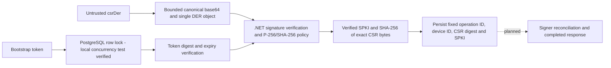

# Enrollment Backend Foundation

Implemented and tested: a .NET 10 CSR verifier, bootstrap-token generation/verification, and an EF Core/Npgsql pending-enrollment model with an initial migration and exclusive claim implementation. Migration, concurrent claims, context-reopen retry, rollback, expiry and selected constraints passed against real PostgreSQL 17.11. This is a class library, not a running ASP.NET Core service. HTTP enrollment/authentication, certificate issuance/completion, response recovery, signer crash reconciliation, mTLS and Android enrollment remain unimplemented.

## Verification Boundary



[EnrollmentCsrVerifier](src/FleetManagement/Enrollment/EnrollmentCsrVerifier.cs) uses the platform PKCS#10 signature verifier with default signature validation. Structured ASN.1 checks enforce the submitted ECDSA/SHA-256 algorithm, absent algorithm parameters, one DER request and no trailing data. The loaded public key must be named-curve P-256, not merely a 256-bit key. Canonical base64 is checked by decoding and exact re-encoding, within the contract's 64..16384 encoded-character bounds.

Successful output contains public SPKI and a lowercase SHA-256 digest of decoded CSR bytes, not subject, SAN, requested extensions or private material. A caller must still authenticate and bind the pending enrollment before issuance. All input rejection uses the same exception message without the input or underlying exception. No logging or network listener is introduced. This verifier is not authorization or attestation; possession of a valid key does not establish device trust or Keystore origin.

The [nineteen-test recorded run](../artifacts/backend/20261016T130626.194302Z/replay.html) covers a generated valid request and returned key/digest, untrusted subject/SAN handling, tampered and wrong-key signatures, wrong hash/curve, RSA, malformed input, encoded size, whitespace, PEM, concatenated objects, indefinite-length BER and noncanonical base64 padding bits. Keys exist only in test-process memory. Shared contract fixture CSR strings remain synthetic, not crypto fixtures.

## Bootstrap Tokens

[EnrollmentBootstrapTokens](src/FleetManagement/Enrollment/EnrollmentBootstrapTokens.cs) generates 32 cryptographically random bytes, represented as canonical unpadded base64url. An issued value separates the transient secret from the persistable credential: pending-enrollment UUID, HMAC-SHA-256 digest, issue time and original expiry. The digest covers a versioned domain separator, normalized pending ID and token, using a caller-supplied secret key of at least 32 bytes. The caller must provision a cryptographically random digest key outside Git; length validation does not prove key entropy. The component does not retain the key.

Lifetimes must be positive and at most fifteen minutes. An injected `TimeProvider` makes deadline checks deterministic; verification rejects tokens at the exact expiry, future issuance, invalid stored lifetimes, malformed credentials, other pending IDs, wrong keys and noncanonical/oversized tokens. Digest comparison uses the platform fixed-time API. This does not claim an end-to-end constant-time request path or enrollment-existence protection; HTTP lookup, authentication responses and rate limits remain to be implemented.

Token verification alone is deliberately non-consuming and never extends expiry. The claim transaction below binds a verified CSR to one operation; complete issuance and exact-request response recovery remain pending. A `true` token result is not durable redemption or permission to issue a certificate without that transaction. The transient secret is excluded from default JSON serialization and redacted by `ToString`; delivery to an authorized administrator must be explicit. These defaults do not prevent explicit property logging or debugger access. Managed secret strings cannot be reliably zeroed; temporary byte buffers are cleared where practical. Key rotation/versioning and secret-store integration remain pending; changing the key invalidates credentials unless a future versioned key policy preserves the original key for their bounded lifetime.

The [token-slice recorded run](../artifacts/backend/20261016T131320.828382Z/replay.html) passed forty-two tests: twenty-three token cases plus nineteen CSR cases. Tests use random in-memory keys/tokens and retain no secret values in expected output. The [first token build](../artifacts/backend/20261016T131116.098388Z/replay.html) failed on an unsupported hex-decoder API and remains failed; the [corrected thirty-nine-test run](../artifacts/backend/20261016T131158.535849Z/replay.html) predates three additional token cases.

## PostgreSQL Claims

[PostgresEnrollmentClaims](src/FleetManagement/Enrollment/PostgresEnrollmentClaims.cs) creates a context per operation through `IDbContextFactory`, never a shared worker context. Registration persists only the keyed credential. Claiming starts a read-committed transaction, selects the pending UUID with parameterized `FOR UPDATE`, authenticates the original token before exposing CSR conflicts, verifies the CSR, and checks expiry again after crypto work. A first claim persists server-generated operation/device UUIDs, exact CSR digest and public SPKI before returning. An exact retry returns the same in-progress IDs; an authenticated different CSR returns conflict without changing them. An invalid token, unknown UUID or expired token returns an identifier-free unauthorized result. Disposing an uncommitted transaction rolls back invalid-input/error paths.

[FleetDbContext](src/FleetManagement/Persistence/FleetDbContext.cs) and its generated migration define unique operation/device IDs, bounded columns and check constraints for digest shape, positive lifetime through fifteen minutes and all-or-none claim fields. EF Core/runtime/design packages are pinned to 10.0.13 and the Npgsql provider to 10.0.3. The design-time factory uses a non-secret, deliberately unconfigured connection for migration generation, not deployment. No database was installed or started for this slice.

The [latest recorded run](../artifacts/backend/20261016T133702.244740Z/replay.html) passed forty-six tests: the original forty-two plus four model/state/migration checks. It verifies provider SQL generation, migration/model consistency and stable claim-state behavior, and compiles the separate real-PostgreSQL test project. It also records library-private design-time dependencies, extending the earlier [forty-six-test migration run](../artifacts/backend/20261016T133311.619306Z/replay.html). It does not execute SQL or establish locking, persistence, concurrency, database constraints or restart durability. The [first dependency restore failure](../artifacts/backend/20261016T132049.237971Z/replay.html) and [EF assembly mismatch failure](../artifacts/backend/20261016T132351.266617Z/replay.html) remain failed. Patched/aligned packages subsequently passed [forty-five tests](../artifacts/backend/20261016T132553.586711Z/replay.html); the [integration-project compilation run](../artifacts/backend/20261016T132816.421590Z/replay.html) also passed those forty-five, before the final migration check was added.

There is no signing worker, completed certificate response, audited administrator route or uncertain-signing reconciliation. `InProgress` is not permission to invoke the signer again; a future worker must reconcile the existing operation, not create a replacement identity. Do not expose this library directly as an enrollment endpoint. HTTP body/duplicate-key validation, rate limiting, redaction and bounded database/lock timeouts remain required before wiring a server.

### Real Database Gate

The [private PostgreSQL lab guide](../docs/postgres-lab.md) provides a checksum-pinned, project-local installation and a recorded Unix-socket-only test workflow. It does not require Docker, a global service or credentials in chat. The runner retains initialization, settings, executable hashes, test results and shutdown; installation alone does not pass this gate.

[EnrollmentClaimTests](tests/FleetManagement.Postgres.Tests/EnrollmentClaimTests.cs) requires `FLEET_TEST_POSTGRES`, set directly in your terminal to an authorized disposable PostgreSQL connection. Do not place credentials in Git, command arguments or chat. The test creates a randomly named `fleet_test_<UUID>` schema, applies the migration there, and drops only that schema in cleanup; the database and unrelated schemas are not deleted. It requires schema-creation privileges and must not target production.

```sh
python3 tools/check_backend.py --postgres
```

The separate test never silently skips: absent configuration or an unavailable database fails. The [recorded PostgreSQL 17.11 run](../artifacts/postgres/20261016T151840.312440Z/replay.html) passed its one integration scenario: migration application, eight simultaneous same-CSR claims (one winner, seven in-progress results), context reopen/retry retaining IDs, authenticated different-CSR conflict, unauthorized/unknown/wrongly-bound tokens, invalid-CSR rollback and exact expiry. It also verified all-or-none claim and lifetime check constraints and the unique device-ID constraint. The [nested backend replay](../artifacts/postgres/20261016T151840.312440Z/backend/replay.html) retains TRX results, six passing installer/lifecycle tests, source snapshots and dependency details.

The wrapper recorded no TCP listener, socket permissions `0700`, `fsync=on`, `synchronous_commit=on`, zero remaining test schemas and successful server shutdown. PostgreSQL remains installed only under ignored `.lab-private/postgres-install/17.11`; no login service or global PATH changes were made. Docker was not used or managed by this workflow; a final process check found Docker Desktop running and left it untouched. No emulator was started. Context reopen is not a PostgreSQL process-restart or power-loss test. Signing crash recovery and production database operations require additional future work. The earlier component-only run above remains historical evidence, not the database result.

## Run and Replay

Install the x64/arm64 .NET SDK appropriate for your host. [global.json](global.json) pins SDK 10.0.402 exactly; the recorded Intel macOS run used runtime 10.0.13. From the repository root:

```sh
python3 tools/check_backend.py
```

The [runner](../tools/check_backend.py) copies backend source/configuration and itself into `artifacts/backend/<UTC timestamp>/inputs/`, runs the copied test project, and saves SDK details, stdout/stderr, exact commands, resolved direct/transitive NuGet versions, input/result hashes, TRX counters and an HTML replay. A pass requires every test to pass, with at least one test and no skipped tests. Failed runs remain failed. Text-based component tests have no Android screenshots/video and establish no end-to-end enrollment behavior. Hashes are consistency checks, not signed provenance. Direct package versions are pinned; transitive versions are recorded, not yet lockfile-enforced.

To rerun a saved snapshot, enter its `inputs/backend` directory and run:

```sh
dotnet test tests/FleetManagement.Tests/FleetManagement.Tests.csproj \
  --logger 'trx;LogFileName=rerun.trx' --results-directory /tmp/fleet-csr-rerun
```

The [first direct check](../artifacts/backend/20261016T130304Z-csr-first-check/tests.trx) retains fifteen passing tests and command output, but predates source snapshots/dependency capture. The [first snapshot run](../artifacts/backend/20261016T130516.680037Z/replay.html) also passed fifteen tests. These earlier runs are not evidence of the four later rejection cases. No emulator or Docker is required.