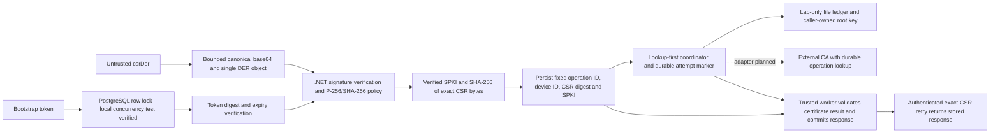

# Enrollment Backend Foundation

The [administrator provisioning boundary](../docs/administrator-enrollment.md) adds issuer-validated access tokens, an exact creation permission, one-time bootstrap-secret delivery and an atomic pending-enrollment/actor-audit save. Four migrations are now required. This extends the earlier library/HTTP foundation described below; it does not add browser login, a hosted identity provider, Android enrollment or a full immutable audit system.

The [enrollment HTTP lab](../docs/enrollment-http.md) now exposes the existing claim/signing/completion flow through an ASP.NET Core HTTPS endpoint with bounded strict JSON parsing, bootstrap bearer authentication, process-local rate limiting and generic problem responses. See that runbook for explicit key/database/TLS configuration and verification limits. Statements below about earlier library-only slices describe their historical scope; this host does not add administrator token-delivery routes, Android enrollment or production CA integration.

Implemented and tested: .NET 10 CSR/token/certificate-result components, EF Core/Npgsql claim/completion storage with three migrations, a lookup-first signing coordinator, a local-filesystem lab signer and an ASP.NET Core enrollment host. Validated completion is first-write-wins, bound to fixed operation/device IDs, and recoverable with the original still-valid token and exact CSR. A committed attempt marker prevents blind reissuance after uncertainty. PostgreSQL tests cover concurrency, rollback, expiry, controlled fast restart and in-process HTTP replay; separate component tests verify loopback TLS. Production CA integration, administrator token-delivery routes, hosted scheduling, revocation, mTLS and Android enrollment remain unimplemented.

## Editor Setup

Open [FleetManagement.slnx](FleetManagement.slnx) for C# editing. It contains only the five live backend projects, including the API host, not the historical source snapshots under `artifacts`. The repository's VS Code settings select this solution and exclude evidence from search and file watching without deleting it. When opening a parent folder containing multiple repositories, select this solution from the C# Dev Kit `No Solution` status item or configure `dotnet.defaultSolution` relative to that parent folder. Reload the VS Code window after changing the default if the discovery warning persists.

## Verification Boundary



[EnrollmentCsrVerifier](src/FleetManagement/Enrollment/EnrollmentCsrVerifier.cs) uses the platform PKCS#10 signature verifier with default signature validation. Structured ASN.1 checks enforce the submitted ECDSA/SHA-256 algorithm, absent algorithm parameters, one DER request and no trailing data. The loaded public key must be named-curve P-256, not merely a 256-bit key. Canonical base64 is checked by decoding and exact re-encoding, within the contract's 64..16384 encoded-character bounds.

Successful output contains public SPKI and a lowercase SHA-256 digest of decoded CSR bytes, not subject, SAN, requested extensions or private material. A caller must still authenticate and bind the pending enrollment before issuance. All input rejection uses the same exception message without the input or underlying exception. No logging or network listener is introduced. This verifier is not authorization or attestation; possession of a valid key does not establish device trust or Keystore origin.

The [nineteen-test recorded run](../artifacts/backend/20261016T130626.194302Z/replay.html) covers a generated valid request and returned key/digest, untrusted subject/SAN handling, tampered and wrong-key signatures, wrong hash/curve, RSA, malformed input, encoded size, whitespace, PEM, concatenated objects, indefinite-length BER and noncanonical base64 padding bits. Keys exist only in test-process memory. Shared contract fixture CSR strings remain synthetic, not crypto fixtures.

## Certificate Completion Boundary

[EnrollmentCertificateVerifier](src/FleetManagement/Enrollment/EnrollmentCertificateVerifier.cs) validates a prospective signer result before completion storage. It requires canonical bounded base64 containing exactly one certificate, the claimed P-256 public key, ECDSA/SHA-256 leaf signing, a non-CA leaf with only digital-signature key usage and client-auth EKU, and exactly the server-assigned SAN URI `urn:fleet:device:<UUID>`. CSR subject/SAN values do not select this identity. Certificate validity comes from the certificate, must include the supplied current time (exclusive expiry), and must fit a caller-configured maximum lifetime.

Chain construction uses only the caller's explicitly configured root and up to four distinct supplied intermediates in leaf-to-root order, without a returned root, unrelated chain entries or certificate downloads. Offline revocation checking is disabled; this does not establish revocation status or replace future authorization/revocation enforcement. The caller must securely configure trust, lifetime and clock. Returned public certificate data is not an HTTP serializer or a persisted completion response; no logging is introduced.

The [passing component run](../artifacts/backend/20261016T203514.246584Z/replay.html) includes generated-certificate tests for valid pinned trust, device/key/root mismatch, validity/maximum-lifetime bounds, malformed/noncanonical/trailing/oversized input, returned root/duplicate/oversized chains, CA leaves, server EKU and extra DNS identity. The [initial build failure](../artifacts/backend/20261016T203159.413012Z/replay.html) used an unavailable SAN URI helper and remains failed; the corrected implementation compares exact SAN DER built by the platform API. Positive intermediate-chain coverage and additional malformed-extension cases remain future coverage. No signer, durable completion or uncertain-signing reconciliation is implemented by this component.

## Bootstrap Tokens

[EnrollmentBootstrapTokens](src/FleetManagement/Enrollment/EnrollmentBootstrapTokens.cs) generates 32 cryptographically random bytes, represented as canonical unpadded base64url. An issued value separates the transient secret from the persistable credential: pending-enrollment UUID, HMAC-SHA-256 digest, issue time and original expiry. The digest covers a versioned domain separator, normalized pending ID and token, using a caller-supplied secret key of at least 32 bytes. The caller must provision a cryptographically random digest key outside Git; length validation does not prove key entropy. The component does not retain the key.

Lifetimes must be positive and at most fifteen minutes. An injected `TimeProvider` makes deadline checks deterministic; verification rejects tokens at the exact expiry, future issuance, invalid stored lifetimes, malformed credentials, other pending IDs, wrong keys and noncanonical/oversized tokens. Digest comparison uses the platform fixed-time API. This does not claim an end-to-end constant-time request path or enrollment-existence protection; HTTP lookup, authentication responses and rate limits remain to be implemented.

Token verification alone is deliberately non-consuming and never extends expiry. The claim transaction below binds a verified CSR to one operation; completed-response recovery also requires that original token and deadline. Signing remains pending. A `true` token result is not durable redemption or permission to issue a certificate without that transaction. The transient secret is excluded from default JSON serialization and redacted by `ToString`; delivery to an authorized administrator must be explicit. These defaults do not prevent explicit property logging or debugger access. Managed secret strings cannot be reliably zeroed; temporary byte buffers are cleared where practical. Key rotation/versioning and secret-store integration remain pending; changing the key invalidates credentials unless a future versioned key policy preserves the original key for their bounded lifetime.

The [token-slice recorded run](../artifacts/backend/20261016T131320.828382Z/replay.html) passed forty-two tests: twenty-three token cases plus nineteen CSR cases. Tests use random in-memory keys/tokens and retain no secret values in expected output. The [first token build](../artifacts/backend/20261016T131116.098388Z/replay.html) failed on an unsupported hex-decoder API and remains failed; the [corrected thirty-nine-test run](../artifacts/backend/20261016T131158.535849Z/replay.html) predates three additional token cases.

## PostgreSQL Claims

[PostgresEnrollmentClaims](src/FleetManagement/Enrollment/PostgresEnrollmentClaims.cs) creates a context per operation through `IDbContextFactory`, never a shared worker context. Registration persists only the keyed credential. Claiming starts a read-committed transaction, selects the pending UUID with parameterized `FOR UPDATE`, authenticates the original token before exposing CSR conflicts, verifies the CSR, and checks expiry again after crypto work. A first claim persists server-generated operation/device UUIDs, exact CSR digest and public SPKI before returning. An exact retry returns the same in-progress IDs; an authenticated different CSR returns conflict without changing them. An invalid token, unknown UUID or expired token returns an identifier-free unauthorized result. Disposing an uncommitted transaction rolls back invalid-input/error paths.

[FleetDbContext](src/FleetManagement/Persistence/FleetDbContext.cs) and its generated migration define unique operation/device IDs, bounded columns and check constraints for digest shape, positive lifetime through fifteen minutes and all-or-none claim fields. EF Core/runtime/design packages are pinned to 10.0.13 and the Npgsql provider to 10.0.3. The design-time factory uses a non-secret, deliberately unconfigured connection for migration generation, not deployment. No database was installed or started for this slice.

The [latest recorded run](../artifacts/backend/20261016T133702.244740Z/replay.html) passed forty-six tests: the original forty-two plus four model/state/migration checks. It verifies provider SQL generation, migration/model consistency and stable claim-state behavior, and compiles the separate real-PostgreSQL test project. It also records library-private design-time dependencies, extending the earlier [forty-six-test migration run](../artifacts/backend/20261016T133311.619306Z/replay.html). It does not execute SQL or establish locking, persistence, concurrency, database constraints or restart durability. The [first dependency restore failure](../artifacts/backend/20261016T132049.237971Z/replay.html) and [EF assembly mismatch failure](../artifacts/backend/20261016T132351.266617Z/replay.html) remain failed. Patched/aligned packages subsequently passed [forty-five tests](../artifacts/backend/20261016T132553.586711Z/replay.html); the [integration-project compilation run](../artifacts/backend/20261016T132816.421590Z/replay.html) also passed those forty-five, before the final migration check was added.

The coordinator below reconciles the existing operation; `InProgress` is never permission to issue a replacement identity. There is no real CA adapter, hosted worker, audited administrator route or automatic resolution of permanently uncertain operations. Do not expose this library directly as an enrollment endpoint. HTTP body/duplicate-key validation, rate limiting, redaction and bounded database/lock timeouts remain required before wiring a server.

### Signing Coordination

[EnrollmentSigningCoordinator](src/FleetManagement/Enrollment/EnrollmentSigningCoordinator.cs) is a trusted internal coordinator invoked with the pending ID and fixed operation ID. It reads only a committed claim; completed operations return their stored result without contacting the signer. Otherwise it calls `IEnrollmentSigner.LookupAsync` with the original operation/device IDs, exact CSR digest and verified SPKI. An issued result must carry that exact binding before the existing certificate verifier/completion transaction can persist it. An unknown lookup returns no result and does not attempt issuance; exceptions/cancellation propagate without resetting durable state or logging input.

On an explicit `NotFound`, `TryBeginSigningAsync` locks the pending row, checks the operation, sets `SigningAttempted` once and commits before any `IssueAsync` call. Only the winning caller may issue. Signer I/O runs outside the database transaction. The [third migration](src/FleetManagement/Persistence/Migrations/20261016210434_EnrollmentSigningAttempt.cs) defaults the marker to false and forbids it on unclaimed rows. A later call always looks up the existing operation first; an issued result can complete after a lost reply or failed completion write. Once marked, even a later `NotFound` cannot authorize another issue call. No token is sent to the signer, and internal reconciliation does not renew client recovery authorization.

This deliberately favors duplicate prevention over automatic liveness: cancellation/crash after marking but before calling the signer, a permanently absent result, or invalid signer output can leave the operation unresolved. The marker has no automatic reset or lease expiry. Never clear it or create a replacement operation as an unverified retry mechanism. A future operator workflow must reconcile authoritative signer evidence and audit any recovery decision. A real adapter must durably bind/deduplicate operation IDs, retain original issuance material/results, distinguish unknown from authoritative absence, enforce signing policy, and handle transport retries without duplicating issuance. The interface alone does not provide these guarantees; there is no production CA adapter in this repository.

The [signing database run](../artifacts/postgres/20261016T210746.713204Z/replay.html) passed eleven integration tests and ten tooling tests. Eight coordinator cases use a test-only in-memory signer with a transient root: competing workers, unknown lookup, lost issuance reply, stale `NotFound`, simulated completion-save failure, failure before signing, wrong result binding and invalid certificate. Recovery reuses the same signer double and new coordinator/context; it is not a real external-signer process-restart test. The controlled PostgreSQL restart test additionally proves an unresolved attempt stays blocked and a completed response survives restart. The [component run](../artifacts/backend/20261016T210912.183008Z/replay.html) passed fifty-nine .NET tests and ten tooling tests, including one-attempt state and migration/model consistency. Power loss, ambiguous database commit, real signer durability/deduplication and hosted scheduling are not established. The [earlier coordinator run](../artifacts/postgres/20261016T210601.197550Z/replay.html) predates the unresolved-attempt restart assertion.

### Lab Signer Adapter

[LabLedgerEnrollmentSigner](src/FleetManagement/Enrollment/LabLedgerEnrollmentSigner.cs) implements the signing interface for a trusted, private local lab directory. The caller supplies and retains ownership of a P-256 CA certificate with its private key, a clock and a lifetime from one minute through thirty days. No CA key is generated, exported, stored in the ledger or logged by the adapter. Tests generate ephemeral roots in memory. Use a dedicated absolute directory under ignored `.lab-private`, never a shared/network filesystem, repository-tracked directory or production CA. On Unix the directory is mode `0700` and newly created files are `0600`; Windows ACL provisioning is the operator's responsibility and is not tested here.

An exclusive per-operation file handle fails closed on contention; callers may retry lookup, not bypass the lock. Before signing, a create-new, flushed reservation binds the operation/device IDs, CSR digest, canonical P-256 SPKI and exact issuer certificate. An existing different binding or issuer is rejected. The adapter signs a root-issued non-CA leaf containing only digital-signature usage, client-auth EKU and the server-controlled device URI, with second-aligned bounded validity covered by the issuer. The ledger contains public certificate/request data only, still requiring access control.

The result is written to a create-new temporary file, flushed and renamed without overwrite in the same directory. Recreated adapters return the stored certificate rather than re-signing. A reservation without a published result returns `Unknown`; issuance is permanently blocked, including after a partial write or interrupted signing. Malformed records throw rather than authorize replacement. Cancellation can leave an unresolved reservation. No marker reset, expiry cleanup or automatic repair is provided. Never delete or restore only part of the ledger to retry an operation. The filesystem is trusted: hostile mutation, symlinks, rollback/deletion, directory-entry power-loss durability and cross-host locking are outside this implementation's guarantees. File flush and same-directory rename do not prove power-loss safety or exactly-once cryptographic execution.

The [component replay](../artifacts/backend/20261016T212101.120832Z/replay.html) passed sixty-four .NET tests and ten tooling tests, including five lab signer cases: original valid certificate after reopen, concurrent adapters, reservation-only uncertainty, lock/cancellation handling and invalid input/issuer rejection. The [database replay](../artifacts/postgres/20261016T211929.191670Z/replay.html) passed twelve integration tests and ten tooling tests. The concrete adapter issues a real certificate, completion persistence is deliberately failed, and new adapter/coordinator/context instances recover that original certificate from disk and complete authenticated retry. This is adapter recreation in one test process, not an actual signer-process restart. The existing separate database fast-restart test still uses its own generated certificate, not this file ledger. The [initial platform-guard build failure](../artifacts/backend/20261016T211627.827922Z/replay.html) and [async-assertion build failure](../artifacts/backend/20261016T211705.822454Z/replay.html) remain failed; the [first passing four-case run](../artifacts/backend/20261016T211753.957132Z/replay.html) predates concurrency coverage. No production CA transport, key store, audit, revocation or hosted scheduler is implemented.

### Signer Process Recovery

The [process-recovery replay](../artifacts/backend/20261016T213802.187970Z/replay.html) passed sixty-six .NET tests and ten tooling tests. Two [subprocess tests](tests/FleetManagement.Tests/EnrollmentSignerProcessTests.cs) launch the actual lab signer in a separate .NET process, then launch fresh processes for lookup and repeat issuance. They require the exact original certificate, validate it against the original root/device/key, and check one reservation, one published result and no partial file. One case exits normally; the other forcibly terminates the child after it publishes a certificate and signals the parent. This establishes recovery after signer-process exit/termination following publication, not just adapter recreation.

The [test-only probe](tests/FleetManagement.SignerProbe/SignerProbe.cs) receives an ephemeral generated root's public DER and PKCS#8 private key through redirected stdin, not files, command arguments, logs or evidence. It imports the key in memory, clears decoded key buffers and attaches it to the public certificate. Managed JSON/base64 strings cannot be reliably zeroed. This is test plumbing, not a production key provisioning mechanism or network service. Public certificate output is consumed in memory; retained test logs contain test names and outcomes, not probe input. Child execution has a thirty-second deadline and cleanup terminates any remaining child before removing its temporary ledger. The probe catches errors without exposing exception messages or input.

The earlier [namespace build failure](../artifacts/backend/20261016T213227.587593Z/replay.html), [initial subprocess failure](../artifacts/backend/20261016T213412.206825Z/replay.html), [dependency-manifest attempt](../artifacts/backend/20261016T213529.686725Z/replay.html) and [safe diagnostic run](../artifacts/backend/20261016T213648.187976Z/replay.html) remain failed. The diagnostic identified unsupported ephemeral PKCS#12 loading on macOS; the passing implementation uses in-memory PKCS#8 import instead. No production signer code changed. The replay's generic scope excludes production/external signer integration; these component tests do execute the local lab subprocess.

Termination is deliberately after result publication: crashes during reservation/signing/rename, cross-process lock contention, machine power loss, filesystem rollback and combined PostgreSQL/signer restart remain unverified. The existing reservation-only test is simulated state, not an actual mid-signing process kill. No new database test was run for this test-only slice; the latest twelve-case PostgreSQL evidence above remains applicable only to its recorded sources and scenarios.

### Durable Completion

`PostgresEnrollmentClaims.CompleteAsync` is a trusted internal worker boundary, not a client-authorized method or signing operation. It locks the pending row and requires the existing operation ID. The first result is validated against the claimed public key/device ID and caller-configured root/maximum lifetime, serialized with web JSON names, and committed before return. A repeated completion returns the persisted result without replacement or re-signing, even when supplied different candidate material. It deliberately does not require the bootstrap token to remain live: internal reconciliation may finish after that deadline, but client recovery may not.

The [completion migration](src/FleetManagement/Persistence/Migrations/20261016205321_EnrollmentCompletion.cs) adds nullable `CompletedResponseJson`, bounded to 100000 characters. Its database constraint requires an existing claim and JSON object carrying schema version 1 and the same device UUID. This is a consistency guard, not full certificate/schema validation or protection against privileged direct database writes. Existing rows remain incomplete. No private key, token or digest key enters the response. The certificate and validity metadata are retained, not regenerated on retry; HTTP status/header handling and byte-for-byte HTTP response replay remain future work.

`ClaimAsync` authenticates before parsing the CSR or exposing a result, checks the original expiry again after verification, and returns `Completed` with the stored response only for the exact CSR. Other authenticated CSRs conflict without response data; invalid/expired tokens remain identifier-free unauthorized. Recovery does not extend token or certificate validity. Revocation/disabled-identity lookup and certificate revalidation on recovery are not implemented, so this must not be wired as a production enrollment route yet.

The [completion database run](../artifacts/postgres/20261016T205603.076038Z/replay.html) passed three integration scenarios and ten tooling tests. Coverage includes eight competing completions with two valid candidate certificates converging on one original result, invalid-certificate rollback, wrong operation, same-CSR recovery through a new context, different-CSR conflict, invalid/expired-token denial, the device-binding constraint, and recovery of certificate/chain/validity after an actual fast PostgreSQL restart. The [component regression](../artifacts/backend/20261016T205747.289860Z/replay.html) passed fifty-eight .NET tests plus ten tooling tests, including first-write-wins state and migration/model consistency. The [earlier completion run](../artifacts/postgres/20261016T205422.069507Z/replay.html) predates the completed-response restart assertions. Power loss, uncertain-signing reconciliation, signer deduplication, revocation, positive intermediate-chain coverage and HTTP response semantics remain unverified.

### Real Database Gate

The [controlled fast-restart run](../artifacts/postgres/20261016T154700.897152Z/replay.html) passed two integration tests and ten tooling tests. The additional test commits a claim, verifies an actual postmaster restart, then checks retained operation/device IDs, CSR digest and original expiry, with private socket and durability settings unchanged. The private runner explicitly opts in and requires the named passing TRX result. Ordinary external-database runs exclude restart tests. The [latest component regression](../artifacts/backend/20261016T155007.896710Z/replay.html) passed forty-six .NET tests and ten tooling tests. This extends context-reopen evidence to controlled fast restart, not power-loss, immediate-crash or signer recovery.

The [private PostgreSQL lab guide](../docs/postgres-lab.md) provides a checksum-pinned, project-local installation and a recorded Unix-socket-only test workflow. It does not require Docker, a global service or credentials in chat. The runner retains initialization, settings, executable hashes, test results and shutdown; installation alone does not pass this gate.

[EnrollmentClaimTests](tests/FleetManagement.Postgres.Tests/EnrollmentClaimTests.cs) requires `FLEET_TEST_POSTGRES`, set directly in your terminal to an authorized disposable PostgreSQL connection. Do not place credentials in Git, command arguments or chat. The test creates a randomly named `fleet_test_<UUID>` schema, applies the migration there, and drops only that schema in cleanup; the database and unrelated schemas are not deleted. It requires schema-creation privileges and must not target production.

```sh
python3 tools/check_backend.py --postgres
```

The separate test never silently skips: absent configuration or an unavailable database fails. The [recorded PostgreSQL 17.11 run](../artifacts/postgres/20261016T151840.312440Z/replay.html) passed its one integration scenario: migration application, eight simultaneous same-CSR claims (one winner, seven in-progress results), context reopen/retry retaining IDs, authenticated different-CSR conflict, unauthorized/unknown/wrongly-bound tokens, invalid-CSR rollback and exact expiry. It also verified all-or-none claim and lifetime check constraints and the unique device-ID constraint. The [nested backend replay](../artifacts/postgres/20261016T151840.312440Z/backend/replay.html) retains TRX results, six passing installer/lifecycle tests, source snapshots and dependency details.

The wrapper recorded no TCP listener, socket permissions `0700`, `fsync=on`, `synchronous_commit=on`, zero remaining test schemas and successful server shutdown. PostgreSQL remains installed only under ignored `.lab-private/postgres-install/17.11`; no login service or global PATH changes were made. Docker was not used or managed by this workflow; a final process check found Docker Desktop running and left it untouched. No emulator was started. Context reopen is not a PostgreSQL process-restart or power-loss test. Signing crash recovery and production database operations require additional future work. The earlier component-only run above remains historical evidence, not the database result.

## Run and Replay

Install the x64/arm64 .NET SDK appropriate for your host. [global.json](global.json) pins SDK 10.0.402 exactly; the recorded Intel macOS run used runtime 10.0.13. From the repository root:

```sh
python3 tools/check_backend.py
```

The [runner](../tools/check_backend.py) copies backend source/configuration and itself into `artifacts/backend/<UTC timestamp>/inputs/`, runs the copied test project, and saves SDK details, stdout/stderr, exact commands, resolved direct/transitive NuGet versions, input/result hashes, TRX counters and an HTML replay. A pass requires every test to pass, with at least one test and no skipped tests. Failed runs remain failed. Text-based component tests have no Android screenshots/video and establish no end-to-end enrollment behavior. Hashes are consistency checks, not signed provenance. Direct package versions are pinned; transitive versions are recorded, not yet lockfile-enforced.

To rerun a saved snapshot, enter its `inputs/backend` directory and run:

```sh
dotnet test tests/FleetManagement.Tests/FleetManagement.Tests.csproj \
  --logger 'trx;LogFileName=rerun.trx' --results-directory /tmp/fleet-csr-rerun
```

The [first direct check](../artifacts/backend/20261016T130304Z-csr-first-check/tests.trx) retains fifteen passing tests and command output, but predates source snapshots/dependency capture. The [first snapshot run](../artifacts/backend/20261016T130516.680037Z/replay.html) also passed fifteen tests. These earlier runs are not evidence of the four later rejection cases. No emulator or Docker is required.