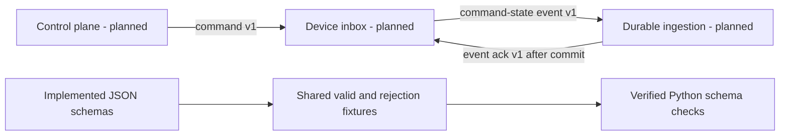

# Fleet Contracts

Implemented and Python-verified: JSON Schema Draft 2020-12 command, command-state event and durable event acknowledgement v1 shapes; enrollment request/response/problem shapes; and the [OpenAPI 3.1 enrollment contract](openapi.json), with shared acceptance/rejection fixtures. The separate [.NET foundation](../backend/README.md) implements CSR/token/certificate-result checks, EF/Npgsql claim/completion transactions and a lookup-first signing coordinator with durable attempt fencing. PostgreSQL tests cover concurrency, authenticated recovery, rollback, expiry, constraints, controlled restart and simulated signer faults. The signer is an in-memory test double in those cases. Not implemented: a real CA adapter with durable lookup/deduplication, hosted scheduling, audited uncertain-operation recovery, HTTP endpoints, Kotlin/.NET JSON contract validators, functional enrollment, revocation, MQTT command transport or HTTP authorization. Schema/spec success is not runtime or security verification.

## Flow



## Wire Rules

- [Command v1](events/command-v1.schema.json): `SET_POLICY` references an immutable policy ID/version; `INSTALL_RELEASE` references a release ID, never arbitrary APK URLs or shell commands; `REQUEST_SYNC` has an empty payload. Referenced resources require authenticated retrieval and independent verification in later implementations.
- [Command-state event v1](events/command-event-v1.schema.json): device states are `received`, `running`, `succeeded`, `failed`, or `expired`. `pending` belongs to server state only. Failed events require a bounded machine-readable error code; other states forbid it. No freeform diagnostic text or credentials belong in these messages.
- [Event acknowledgement v1](events/event-ack-v1.schema.json): acknowledges one event ID for one device after durable server ingestion. `receivedAt` is the server ingestion time; device events separately retain `recordedAt`. Duplicate ingestion returns the original durable acknowledgement. An MQTT PUBACK is not this acknowledgement and is not command success.
- Every envelope has integer `schemaVersion: 1`. Unknown properties and unsupported versions/types are rejected; version changes require explicit consumer compatibility work, not permissive parsing.
- Identifiers use UUID strings. Sequences and policy versions are positive JSON-safe integers through 9007199254740991. Sequences are per-device; consumers must normalize identifiers consistently before authorization or deduplication.
- Timestamps use RFC 3339 with an explicit timezone. Consumers must enable format assertions; JSON Schema's format annotations alone are not validation. The Python checks use `FormatChecker`.

These schemas enforce shape, not cross-message or temporal invariants. Later producers/consumers must enforce authenticated device/topic binding, `expiresAt > issuedAt`, expiry before execution, clock-skew policy, sequence/supersession rules, valid lifecycle transitions, command/correlation ownership, event ID uniqueness, and acknowledgement authenticity. An expired deadline does not undo a committed installation. Devices persist events before publication and remove them only after authentic matching durable acknowledgement; PostgreSQL and Room integration tests must establish those guarantees.

## Shared Fixtures

Each fixture suite names its schema relative to `contracts/` and contains complete `valid` messages. Each `invalid` case selects a zero-based valid `base`, replaces top-level fields using `set`, then deletes fields in `remove`. Replacements replace the entire value, including nested payloads; they are not merge patches. Kotlin and .NET tests should expand these same files rather than fork expected outcomes. Fixture acceptance only establishes schema conformance, not that historical example timestamps are currently executable. Enrollment CSR/certificate fixture strings are synthetic base64 shapes, not valid cryptographic material.

## Enrollment Contract

The [enrollment design](enrollment.md) defines token-bound CSR submission over server-authenticated TLS, server-assigned identity, exact-request retry of a single durable issuance, no-store/error metadata and later mTLS authorization. These are required backend semantics, not functional server behavior. The Python tests validate OpenAPI structure/references, declared HTTP security/response boundaries, body shapes and encoded-size/chain bounds. They do not verify CSR signatures, certificates, token redemption, expiry, durable transactions or concurrency. The [six-check recorded run](../artifacts/contracts/20261016T125637.174195Z/replay.html) covers thirteen valid and fifty-eight rejection fixtures, plus explicit size-boundary checks. Separately, the [.NET component](../backend/README.md) verifies actual CSR signatures and key/encoding policy with nineteen passing tests; it is not an HTTP server or a consumer of these JSON schemas.

The separate [.NET bootstrap-token component](../backend/README.md#bootstrap-tokens) generates bounded opaque tokens and verifies enrollment-bound HMAC digests and original expiry. Its tests do not establish HTTP authentication, persistent one-use redemption or certificate issuance; the Python contract checks and synthetic fixtures are unchanged.

## Run and Retain Checks

From the repository root:

```sh
python3 -m venv .lab-private/contracts-venv
.lab-private/contracts-venv/bin/python -m pip install -r tools/contracts-requirements.txt
.lab-private/contracts-venv/bin/python tools/check_contracts.py
```

The runner executes against copied schema/fixture/test inputs, not mutable working-tree files. It retains input copies and SHA-256 hashes, Python and dependency versions, stdout/stderr, exit code, and an HTML replay under `artifacts/contracts/<UTC timestamp>/`. Failed runs remain failed; hashes establish local consistency, not signed provenance. These are text-based checks, not Android screenshots/video or end-to-end evidence. To rerun a saved input snapshot, execute `python -m unittest discover -s tools -p test_contracts.py -v` from that bundle's `inputs` directory using an environment with the recorded dependencies.

The direct JSON Schema and OpenAPI validator dependencies are pinned in [requirements](../tools/contracts-requirements.txt); transitive versions are captured per run, not yet locked for reproducible installation. The next foundation work is backend consumers and cryptographic/persistence enforcement of these enrollment rules, followed by the remaining device/admin HTTP operations.