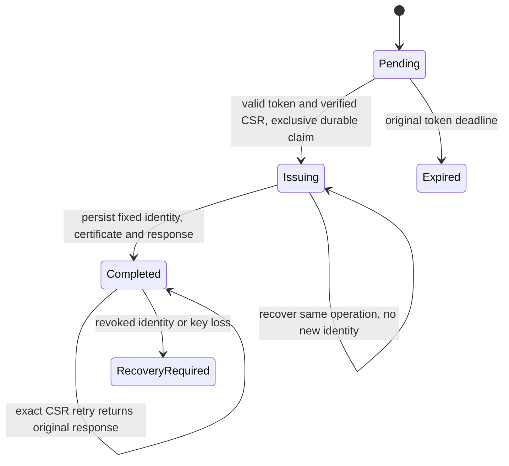

# Enrollment HTTP Contract

Implemented: [OpenAPI 3.1 document](openapi.json), bounded request/response/problem schemas, Python contract checks and [.NET enrollment components](../backend/README.md), including three EF Core migrations, row-locked claim/completion transactions and a lookup-first signing coordinator. Validated completion is first-write-wins; exact-CSR recovery requires the original live token. PostgreSQL tests pass for concurrency, rollback, recovery, expiry, constraints and controlled restart; signing faults use an in-memory test double. Not implemented: a real CA adapter with durable operation lookup/deduplication, hosted scheduling, audited uncertain-operation resolution, HTTP enrollment/token-delivery routes, revocation/disabled-identity enforcement or mTLS. Operational HTTP/issuance rules below remain requirements, not verified server behavior.

## Bootstrap and Identity

A concrete [lab signer](../backend/README.md#lab-signer-adapter) now implements local certificate issuance with a caller-supplied test root and private file ledger. Full operation binding and original results survive adapter recreation; an unresolved reservation fails closed without automatic reissue. The [twelve-case database replay](../artifacts/postgres/20261016T211929.191670Z/replay.html) includes recovery through a recreated adapter after failed completion persistence. This does not add HTTP routes, production CA integration, signer-process restart or power-loss guarantees. The earlier coordinator-only evidence below retains its historical scope.

OS Device Owner provisioning is separate from backend enrollment. An authorized administrator provisions a pending enrollment and a short-lived one-use opaque token. The Android agent generates a P-256 key in Android Keystore and signs a PKCS#10 CSR with SHA-256; private material never leaves the device. The existing lab maintenance key is not a device-enrollment key.

The client submits `POST /api/v1/enrollments` over server-authenticated TLS with `Authorization: Bearer <bootstrap token>`, `Content-Type: application/json`, and the [request](http/enrollment-request-v1.schema.json). No client certificate exists yet, so this route explicitly overrides the planned device-mTLS requirement. Do not use permissive TLS callbacks or trust roots delivered by this response. Bootstrap trust is provisioned separately by an authorized operator.

The token is bound to `pendingEnrollmentId`, expires at its original deadline and is stored only as a keyed digest; digest keys and signing keys remain outside Git. The .NET component generates 256-bit opaque tokens and enrollment-bound HMAC-SHA-256 digests, accepts a caller-selected positive lifetime up to fifteen minutes, and verifies the original deadline. The claim component persists keyed credentials in PostgreSQL. Secure key provisioning/rotation, administrator/OIDC routes, HTTP authentication and rate-limit storage remain backend work. Verification alone neither consumes a token nor enforces one-use issuance. Do not log authorization headers, CSR bodies, certificate responses or tokens; even rejected requests must be redacted.

## Validation Before Issuance

Enforce the 24576-byte body limit before parsing. Reject duplicate JSON keys, unsupported versions, unknown fields and non-JSON content. `csrDer` is standard base64 encoding of DER, bounded to 16384 encoded characters. Decode strictly, check canonical base64, parse exactly one PKCS#10 object with no trailing data, verify proof of possession and enforce P-256/SHA-256 key/signature policy using maintained cryptographic APIs. Never treat a schema-valid string as a verified CSR.

The shared fixture CSR/certificate strings are deliberately synthetic encoding-shape examples, not real cryptographic material. The schema size tests also use synthetic strings. Separate [.NET component tests](../backend/tests/FleetManagement.Tests/EnrollmentCsrVerifierTests.cs) generate real signed requests in memory and cover encoding, proof-of-possession and algorithm rejection. The verifier returns public SPKI and the digest of exact decoded CSR bytes without treating subject/SAN as authority. Kotlin/.NET JSON contract consumers, Android enrollment and certificate validation remain pending.

The server assigns the immutable UUID identity. CSR subject/SAN data must not grant authority or choose the certificate identity. Certificate issuance constructs a server-controlled device identity, client-auth usage and bounded validity. Clients verify the returned certificate chains to preconfigured trust, matches their generated public key and assigned identity, has valid usage and validity, and agrees with response metadata before using it. The [response](http/enrollment-response-v1.schema.json) includes the leaf and up to four distinct intermediates, never a trust-root update or private key. Root-signed leaf chains may have an empty intermediate array. Subsequent HTTPS/MQTT uses mTLS with authorization and revocation checks; certificate presentation alone is not authorization.

## Durable One-Use Semantics

One-use means one issuance operation, not one successful network delivery. New completion returns `201`; an exact decoded-CSR-byte retry using the original still-valid token returns `200` with the same persisted device ID, certificate and timestamps. It must neither renew validity nor create another device. Bind a cryptographic digest of decoded CSR bytes to the pending enrollment; an authenticated different-CSR retry returns `409`. Once the original token expires, even response recovery returns generic `401`. Re-enrollment or key loss requires a separate authorized workflow, not automatic replacement.

The backend must serialize concurrent redemption and preserve the operation identity across issuer/database/network crashes. External certificate signing is not automatically atomic with PostgreSQL: persist an exclusive issuance claim and fixed identity, then reconcile uncertain signing using a durable operation identifier or persisted issuance material. Never recover by blindly generating another identity or certificate. Persist completion and safe audit state before sending success. The implemented claim transaction fixes the operation, identity and CSR; a trusted-worker completion transaction validates and commits one certificate response, returning the existing response rather than replacing it on retries. Internal completion may reconcile after token expiry, but client response recovery still requires the original live token and exact CSR.

The [coordinator](../backend/README.md#signing-coordination) looks up the full operation binding before issuance and commits a one-attempt marker before calling the signer. Once marked, even a later `NotFound` cannot trigger another issuance call; a recovered original result can still complete. Unknown lookups and exceptions do not create replacement identities or reset the marker. Crashes after marking but before signing can therefore remain unresolved; safe authoritative operator recovery is not implemented. The [signing/restart scenarios](../artifacts/postgres/20261016T210746.713204Z/replay.html) verify these paths with real PostgreSQL and an in-memory signer double, including lost reply and failed completion save. A real adapter must retain/deduplicate operations durably and distinguish unknown state from authoritative absence; the interface alone proves none of those external guarantees. There is no real CA adapter, audit/operator-resolution workflow or revocation/disabled-identity check yet. HTTP status/headers and byte-for-byte response replay are not implemented. Controlled database restart and simulated signer faults do not establish power-loss, ambiguous-commit or external-signer process-restart recovery.

## Response Rules

The [subsequent process-recovery tests](../backend/README.md#signer-process-recovery) now verify a fresh local signer process recovering the exact published certificate after normal exit and forced termination following publication. This extends the earlier same-process evidence only for that boundary. It does not establish mid-signing crash recovery, production CA transport, HTTP delivery or power-loss guarantees.

Every response uses `Cache-Control: no-store`. Errors use the bounded [problem shape](http/problem-v1.schema.json), `about:blank`, a generic status title and optional opaque trace ID, without raw exception, token, CSR or account details. `status` must equal the actual HTTP status; schemas do not prove that agreement. Missing/expired/invalid/wrongly-bound tokens share generic `401` with `WWW-Authenticate: Bearer`, without disclosing pending-enrollment existence. Authenticate before exposing a conflict.

Other declared outcomes are `400` for malformed/invalid input, `409` for authenticated conflicts/recovery, `413` for body size, `415` for content type, `429` for rate limiting, and `500`/`503` for server failure/unavailable durable completion. `429` and `503` include bounded seconds in `Retry-After`; clients use bounded jittered backoff and retry the same CSR, never a fresh key to evade uncertain state. Rate-limit before expensive verification/issuance. Proxy-level malformed requests or TLS failures may terminate before application problem responses; test that boundary separately.

## Verification Scope

The [recorded runner](../tools/check_contracts.py) validates the OpenAPI structure and local references, checks declared bootstrap/mTLS separation and HTTP metadata, and applies shared schema fixtures and size-boundary tests. It does not send HTTP requests, inspect certificates or enforce any server behavior. Build/runtime integration tests must establish replay, expiry, concurrency, authorization, redaction, rate limits, durable issuance and certificate matching before enrollment can be called functional.