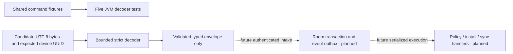

# Android Command Decoding

The follow-up [Room command journal](android-command-journal.md) now consumes this decoder for atomic local receipt/event storage. Its separate six-scenario API 34 replay does not wire live MQTT or execution. The parser-only evidence and historical limits below describe the earlier milestone.

[CommandDecoder](../android/agent/src/main/java/dev/fleet/agent/CommandMessage.kt) is an internal, stateless consumer of the [command v1 contract](../contracts/events/command-v1.schema.json). It produces a typed envelope with `SetPolicy`, `InstallRelease` or `RequestSync` payloads. This is parser infrastructure only: neither the enrolled MQTT transport nor the anonymous diagnostic service calls it. No commands are persisted, executed or acknowledged by this change.



## Receiver Boundary

- Accepts nonempty UTF-8 input through 8192 bytes, including whitespace. Malformed UTF-8, malformed/nonstandard JSON, trailing documents, duplicate fields, unknown fields, nulls and wrong token types fail. Payload fields are checked against the selected command type, regardless of JSON property order. Parsing failures throw; callers must not log raw message bodies or treat exceptions as application acknowledgements.
- Requires all nine envelope fields, integer `schemaVersion: 1`, a supported type and its exact payload. Sequences and policy versions are exact positive integers through 9007199254740991. Numerically integral JSON forms such as `1.0` and `1e0` are accepted without floating-point conversion; quoted numbers, booleans, fractions and overflow are rejected.
- UUIDs must be full hyphenated representations. Uppercase hex is accepted and normalized through `UUID`; shortened Java UUID spellings are rejected. The device ID must equal the caller's expected enrolled UUID. This prevents accidental cross-device intake, but is not evidence of authenticated origin or topic authorization. The future caller must obtain the expected ID from the validated enrollment identity, not untrusted payloads.
- Timestamps require an explicit RFC 3339 offset, valid calendar/time fields, seconds and no more than nine fractional digits. Offsets normalize to `Instant`; `expiresAt` must be strictly later than `issuedAt`. Leap seconds, expanded years and finer-than-nanosecond timestamps are rejected. The schema itself permits more fractional precision; this is an explicit current Android receiver restriction, not a schema change or universal RFC 3339 implementation.
- Decoding does not compare against the current clock. Historical examples remain valid data, not executable work. Admission/execution must later enforce expiry, an explicit clock-skew policy, ordering, supersession, duplicate identity/content rules and serialized side effects. An expired deadline must not undo an already committed installation.

## Verification

The [saved replay](../artifacts/android-enrollment/20261017T095439.171027Z/replay.html) and [manifest](../artifacts/android-enrollment/20261017T095439.171027Z/manifest.json) pass all 30 JVM tests, application/instrumentation APK assembly and Android lint. Five tests belong to this decoder, expanding all three shared valid commands and all fourteen rejection mutations. Additional checks cover each missing envelope field, duplicate envelope/payload fields, wrong-device binding, strict UTF-8, exact size/integer boundaries, malformed JSON, UUID normalization, timestamp offsets/precision/lifetime and typed payloads. The other 25 JVM tests cover the earlier maintenance/enrollment/TLS/MQTT client boundaries. All 68 Python tooling tests also passed. No emulator, broker or PostgreSQL runtime was started for this parser-only milestone; the preceding [Keystore MQTT runtime](android-mqtt-enrollment.md) remains separate evidence.

The manifest records the actual local Gradle launcher/daemon as Java 21.0.8, despite `/usr/libexec/java_home -v 17` resolving to that installed JDK on this host. Java/Kotlin bytecode targets remain 17. Hosted CI installs Java 17 explicitly; a local Java 21 pass is not a hosted Java 17 result. The preceding integration commit `6f54a3e` passed all three jobs in [39022430412](https://github.com/michaelnwanna/custom-android-mdm-agent/actions/runs/39022430412); that run predates this decoder.

Gradle loads [the original shared fixture file](../contracts/fixtures/commands-v1.json) as a JVM-only resource, not an APK asset. Both Android snapshot runners now copy that fixture and its schema into retained inputs, hash them, and require at least 30 passing JVM tests. The combined runner's changed snapshot wiring was not exercised on an emulator in this milestone. From a repository root or retained snapshot's `inputs` directory with Android SDK and a compatible JDK configured:

```sh
cd android
./gradlew :agent:testDebugUnitTest --tests dev.fleet.agent.CommandDecoderTest --console=plain
```

From the repository root, `python3 tools/check_android_enrollment.py` records the full JVM/build/lint snapshot without requiring an emulator. The decoder introduces no new library: it uses the existing Moshi reader, Java time, UUID and exact decimal APIs. Durable Room inbox/outbox, event encoding/acknowledgement validation, authenticated live message handling, backend publishing/ingestion and HTTP reconciliation remain planned.