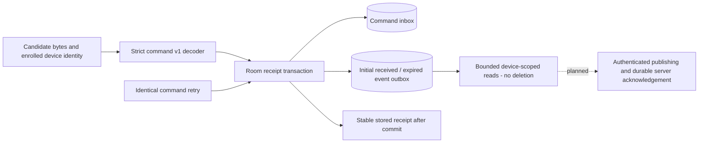

# Android Command Receipt Journal

The internal [CommandJournal](../android/agent/src/main/java/dev/fleet/agent/CommandJournal.kt) records a validated command and its initial command-state event in a single Room transaction. [CommandDatabase](../android/agent/src/main/java/dev/fleet/agent/CommandDatabase.kt) uses Room 2.6.1 with a pinned KSP compiler and an exported version-1 schema. This is a local receipt boundary, not a command execution engine or live fleet synchronization service.



## Transaction Rules

`receive` first applies the [strict decoder](android-command-decoding.md) with the expected device UUID. It serializes normalized typed content to a deterministic JSON representation, then enters one database transaction. Equivalent UUID casing, timestamp offsets, numeric spellings and property order normalize to the same content; unknown properties are rejected rather than discarded. This normalization is private storage behavior, not a signed JSON canonicalization standard.

For a new command, the transaction checks that its device/sequence pair is unused, chooses a random event ID, and inserts both inbox and outbox rows. It returns only after commit. A retry with the same command ID, device and normalized content returns the original event ID and initial state with `duplicate=true`, even after expiry or database close/reopen. Changed content under an existing command ID fails. A different command ID using an existing sequence for the same device fails. A unique device/sequence index backs the transaction check; command IDs and event IDs are primary keys, and the outbox command foreign key restricts deletion. There is no last-writer-wins replacement.

At initial receipt, `now < expiresAt` creates `received`; equality or a later time creates `expired`. The event contains the command, device and correlation IDs, its stable event ID, device-clock `recordedAt` and initial state. A duplicate does not create another event or change its timestamp/state. The journal does not require increasing delivery order: a delayed unused sequence may be received. Ordering, supersession and a future-issued/clock-skew policy remain undefined; execution must recheck expiry before side effects. No `running`, `succeeded` or `failed` transition is implemented.

`pendingEvents` returns only this journal's device events in insertion order, with a caller limit of 1 through 100. Reading does not acknowledge or delete rows. There is deliberately no deletion API until authenticated event acknowledgements and durable backend ingestion exist. Retention is therefore unbounded in this foundation; quotas, backpressure and reclamation require later design. MQTT PUBACK is not an application acknowledgement.

The default opener uses application-private `fleet-command-journal.db`, write-ahead logging and Room's default main-thread restrictions. Callers must dispatch synchronous journal operations off the main thread and handle failures without logging raw command bodies. No application service currently calls the journal; it is not wired to either MQTT diagnostic. Enrollment replacement/reset, device reassignment, database encryption, backup policy and migrations beyond initial schema version 1 are not established here. There is no destructive-migration fallback. The application DB is not created merely by compiling this code.

## Verified Evidence

The [successful replay](../artifacts/android-command-journal/20261017T104715.388162Z/replay.html) and [manifest](../artifacts/android-command-journal/20261017T104715.388162Z/manifest.json) record 32 passing JVM tests, application and instrumentation APK builds, Android lint, and six actual API 34 SQLite instrumentation scenarios:

- Commit, close/reopen and semantically identical replay preserve one command, one event and the original receipt.
- Changed command content and conflicting device/sequence identities fail without changing stored results.
- A test-only SQLite trigger aborts outbox insertion and the inbox insertion rolls back with it; retry after removing the trigger succeeds.
- Eight simultaneous identical deliveries across two Room database handles produce one original receipt/event and seven duplicates.
- Exact expiry creates an `expired` event with stable identifiers/timestamp and a later retry preserves it.
- Outbox reads are bounded, device-scoped and nondeleting; wrong-device receipt and invalid read limits fail.

Two new JVM checks verify normalized command roundtrips and initial event wire shapes against the shared command-state fixtures. These bring the existing 30-test suite to 32. All 69 Python tooling tests also passed, including strict evidence parsing for exactly six successful instrumentation tests. Both Android snapshot runners retain command/event schemas and fixtures and require at least 32 JVM tests. Hosted CI compiles but does not execute the instrumentation class; local API 34 evidence is not hosted runtime coverage. Prior decoder commit `0676404` passed [39023167649](https://github.com/michaelnwanna/custom-android-mdm-agent/actions/runs/39023167649), before this Room implementation.

The [first journal run](../artifacts/android-command-journal/20261017T100748.261156Z/replay.html) remains failed: its Java 21 Gradle daemon crashed during lint before instrumentation. The successful retry explicitly used private Temurin 17.0.20.1, downloaded from the official release and checksum-verified outside the repository's tracked files. Changing the JDK and observing a successful retry does not establish the crash's root cause. The system JDK was not replaced, lint was not skipped, and failed evidence was not rewritten.

Instrumentation uses random disposable database names and removes only those databases. It does not reset enrollment, wipe the AVD or touch the default application journal. A fresh Room handle is not a process restart; concurrent handles run in one instrumentation process. No process kill, power loss, storage exhaustion, multi-process contention, reboot recovery or live network delivery was tested. The API 34-only compatibility boundary remains unchanged.

## Run

With an already ready, explicitly authorized Device Owner emulator and Android SDK configured, from the repository root:

```sh
JAVA_HOME="$PWD/.lab-private/jdk17/jdk-17.0.20.1+1/Contents/Home" \
	python3 tools/check_android_enrollment.py \
	--serial emulator-5554 --expected-avd Pixel_8 --command-journal
```

The private JDK path is specific to this host; supply an existing verified JDK 17 path elsewhere. The runner verifies the AVD name, records build/runtime output, requires exactly six successful instrumentation tests and retains source/schema/fixture copies and hashes under `artifacts/android-command-journal`. Do not provision or wipe an existing device to run this check. Omitting emulator arguments runs only the JVM/build/lint gate, not SQLite runtime tests. The combined enrollment runner's updated fixture-copying path has not been rerun on an emulator in this milestone.

Next work is authenticated intake and durable event delivery, with backend event-ID deduplication and matching acknowledgement validation before outbox deletion. Execution requires serialized handlers, lifecycle transitions and inspection of actual Android effects after interruption; this receipt journal alone does not provide those guarantees.
