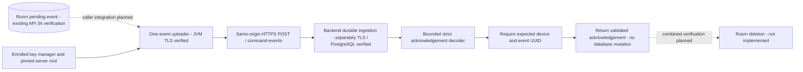

# Android Event Upload Boundary

[CommandEventTransport](../android/agent/src/main/java/dev/fleet/agent/CommandEventTransport.kt) uploads one stored `CommandEventRow` using an existing enrolled `DeviceTlsIdentity` and explicitly supplied server root. [EventAcknowledgementDecoder](../android/agent/src/main/java/dev/fleet/agent/EventAcknowledgement.kt) accepts only a bounded, matching event acknowledgement. These are callable components, not a scheduled synchronization worker. There is no Room deletion or acknowledgement mutation in this milestone.

## Transport Rules

The identity endpoint must be HTTPS at `/api/v1/device/identity`, without user information, query or fragment. The event destination is derived on that same origin as `/api/v1/device/command-events`; an event cannot select another server. TLS uses the supplied pinned root trust store and enrolled key manager, with platform default hostname verification. The uploader sends no bearer credential, refuses redirects, disables connection caching and uses ten-second connect/twenty-second read timeouts. These are socket timeouts, not a total upload deadline, scheduling or retry policy.

The local row must have the enrolled device UUID and a canonical event UUID. Stored wire JSON must be nonempty, at most 8192 UTF-8 bytes, contain matching device/event/command identity fields, reject duplicate fields, and end after one JSON document. Canonical lowercase local row identifiers are intentional: the journal creates them through `UUID.toString()`. This is not a replacement for full backend event validation or protection from a compromised database. Original stored JSON bytes are sent unchanged, without regenerating event IDs or timestamps.

Only status 200 is eligible for acknowledgement decoding. Other statuses, including redirects, produce `DeviceHttpException` with a status code and generic message. Errors are not acknowledgements. The response must be unencoded `application/json`, optionally with UTF-8 charset. A declared size over 4096 bytes is rejected, and an incremental 4097-byte guard handles absent lengths/chunked bodies too. Strict UTF-8 decoding rejects malformed sequences.

The acknowledgement has exactly `schemaVersion`, `deviceId`, `eventId` and `receivedAt`: no duplicates, missing/unknown fields, wrong token types, trailing document or permissive JSON syntax. Version is numerically exactly 1, including equivalent `1.0`/`1e0` forms without floating-point rounding. Full hyphenated UUIDs normalize hex casing and must match the expected device and event. Matching IDs alone do not authenticate an acknowledgement; the HTTPS exchange supplies that trust boundary.

`receivedAt` requires an explicit-timezone timestamp with valid calendar/clock fields, at most nine fractional digits, no leap seconds and no year zero. Java `OffsetDateTime` additionally restricts offsets to its supported range of at most eighteen hours; the server currently generates UTC acknowledgements. The original validated string is preserved. There is no current-clock freshness check: a duplicate can recover an old original acknowledgement.

## Verified Evidence

The [snapshot](../artifacts/android-enrollment/20261017T162936.002009Z/replay.html) and [manifest](../artifacts/android-enrollment/20261017T162936.002009Z/manifest.json) pass 37 JVM tests, application/instrumentation APK assembly and lint with private Temurin 17.0.20.1. Five new tests cover the shared acknowledgement fixture and five rejection mutations, strict parser/identity/precision/UTF-8 cases, real loopback client-authenticated TLS upload with exact stored bytes, original/duplicate replies, wrong trust/hostname, mismatched IDs, oversized chunked replies, unsupported media/encoding, redirects/error statuses and invalid rows/origins rejected before sending.

Both Android snapshot runners retain the acknowledgement schema and fixture alongside command/event inputs and require at least 37 passing JVM tests. A new tooling regression guards those inputs; all 71 Python tooling tests pass. The preceding HTTPS commit `d52210e` passed all three hosted jobs in [39035035122](https://github.com/michaelnwanna/custom-android-mdm-agent/actions/runs/39035035122), which predates this Android follow-up.

TLS tests use software-key certificates and MockWebServer on the JVM, not Android Keystore or the actual backend. The [Kestrel/PostgreSQL proof](command-event-http.md) remains separate. No emulator, PostgreSQL or combined Android/backend runtime was run for this milestone. Tooling regression includes existing host MQTT tests, not new Android MQTT integration.

## Next Boundary

The uploader is not wired into `CommandJournal`, a UI action, service or worker. `pendingEvents` remains read-only and retains every row; no Room migration is needed. Before deletion, combined Android Keystore/Room/HTTPS/PostgreSQL tests must show the pending event survives rejection/lost response, replays to its original committed acknowledgement, and is removed only after authenticated matching validation. Response-loss, process-death/crash recovery, backoff, queue fairness, production command creation, lifecycle execution, MQTT ingestion and full fleet acceptance remain unverified.