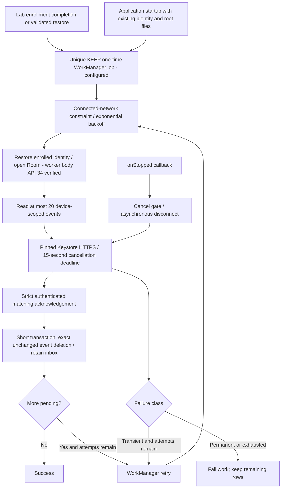

# Bounded Background Event Delivery

Follow-up: the [actual scheduler probe](android-event-scheduler.md) now verifies first-backoff timing, same-ID retry, unique `KEEP` and cancellation before dispatch using real WorkManager and a no-credential debug worker. Earlier absent-scheduler-proof statements below describe this worker-body milestone. JobScheduler-only real event delivery, constraints, OS-driven in-flight cancellation and reboot recovery remain unverified; the probe does not access the default identity or journal.

[EventUploadWorker](../android/agent/src/main/java/dev/fleet/agent/EventUploadWorker.kt) now provides a WorkManager-backed event delivery path. Scheduling/lifecycle hooks are implemented; the worker body is API 34 verified against SQLite/TLS and the enrolled Keystore/PostgreSQL lab. OS scheduling/backoff timing, reboot resumption and OS-driven stop callbacks remain unverified. This is not full offline fleet acceptance or a production command receiver.



## Scheduling and Identity

WorkManager runtime/testing are pinned to 2.9.1, compatible with compile SDK 34. A one-time request has connected-network constraints, exponential backoff starting at thirty seconds, and unique name `fleet-command-event-upload` with `ExistingWorkPolicy.KEEP`. Enqueue while an existing generation is unfinished does not replace it. Completed/failed/cancelled work can be enqueued again with a fresh attempt budget. This is not periodic work or indefinite retry.

[The application](../android/agent/src/main/AndroidManifest.xml) schedules on process startup only when the existing default enrollment journal and both app-private root files are present. [LabEnrollment](../android/agent/src/main/java/dev/fleet/agent/LabEnrollment.kt) schedules after successful enrollment or validated restore. WorkManager supplies persisted-work recovery machinery; no custom polling service or alarm is added. These hooks are compiled/linted, not an observed startup/reboot scheduling acceptance test. Future durable command producers must enqueue after committing receipts; the MQTT callback remains test-only.

The public two-argument worker constructor restores only the normal `device` enrollment namespace, verifies Device Owner, reads the bounded single-certificate server/device root files and calls `tlsIdentity`. That call verifies the persisted endpoint/root binding, completed response and existing non-exportable key. The worker never calls `prepare`, creates replacement keys, consumes bootstrap tokens or overrides roots from event/acknowledgement bytes. WorkManager input contains no key, certificate, token, URL, namespace or event body. Tests use an internal session factory for isolated databases/identities, not an alternative acknowledgement validator.

## Bounds and Failures

Each execution snapshots at most twenty pending rows and delivers them sequentially through [authenticated journal deletion](android-event-acknowledgement.md), without a Room transaction across HTTPS. The database session closes on success or exception. Framework results are generic, with a delivered count on success; this implementation does not log raw bodies or exceptions.

There are at most five attempts per work generation (counts 0 through 4). Both transient failure and successful partial batch use `Result.retry`; continuation consumes the same budget. At most one hundred events can be drained per generation, and failures reduce capacity. Attempt 4 may execute but cannot retry; attempt 5 or greater is rejected before opening a session. Larger backlogs remain durable until another enqueue/startup generation. This is not a global lifetime cap.

HTTP 408, 425, 429, 500, 502, 503 and 504, ordinary I/O/socket failures and controlled deadlines are transient. TLS errors are classified before general I/O and fail closed without automatic retries. Authentication/ownership errors such as 401/403/409, malformed acknowledgements, invalid bindings, missing identity/configuration and other local failures stop work with rows retained. SQLite exceptions also stop rather than spin; repair/re-enqueue is required. Partial successes remain deleted while the failing and later events remain pending. A permanent head event can block that generation; quarantine, fairness, per-event budgets and remediation UI are not implemented. Server `Retry-After` is not consumed; local WorkManager backoff applies.

## Cancellation and Deadline

Each controlled request has a fifteen-second cancellation deadline in addition to the existing ten-second connect/twenty-second read socket timeouts. The deadline starts before network I/O, not before identity restoration or disk work. It marks delivery cancelled and submits disconnect on a separate two-thread daemon executor, keeping `onStopped` and the deadline thread away from potentially blocking Android networking locks. Disconnect is best-effort, not a universal hard wall-clock bound on OS/DNS/SQLite calls.

The control checks thread interruption, serializes cancellation against the short delete transaction, and rejects deletion if cancellation won before that transaction started. Already committed deletion is not undone. A server-committed/client-stopped event remains replayable to its original durable acknowledgement. Deadline cancellation is retryable within the budget; WorkManager owns stopped-work rescheduling and ignores stopped workers' results. The stop test invokes `onStopped` directly, not OS cancellation.

## Verified Evidence

- [Final six-scenario API 34 worker replay](../artifacts/android-event-worker/20261017T180246.203802Z/replay.html): a 21-event backlog uploads twenty and returns retry, then the next attempt removes the last event while preserving inbox rows. A 503 preserves exact wire content for retry. Permanent/exhausted failures retain the event. The stop callback during a request prevents deletion. A valid reply delayed eighteen seconds is rejected by the fifteen-second deadline. Request inspection verifies connected constraints, exponential thirty-second backoff and empty input data. These are SQLite/software-key loopback mTLS tests through WorkManager's test builder, not OS job dispatch.
- [Combined worker-body replay](../artifacts/android-backend-event-worker/20261017T180015.034345Z/replay.html), [device proof](../artifacts/android-backend-event-worker/20261017T180015.034345Z/device-public-proof.json) and [host proof](../artifacts/android-backend-event-worker/20261017T180015.034345Z/backend-verification.json): actual enrolled Keystore/Room/HTTPS/PostgreSQL post-commit 503 returns retry with the row intact; original acknowledgement recovery, local delete rollback/reopen and a later worker attempt delete only that event. Inbox replay creates no new event; disabled-device failure preserves a new event. The host independently verifies one original event/acknowledgement, one suppression, three identical duplicate acknowledgements and required worker proof flags. Worker execution is via the test builder, not scheduled backoff.
- [Five acknowledgement regressions](../artifacts/android-event-acknowledgements/20261017T180356.608926Z/replay.html) still pass exact-row isolation, rejection retention, rollback/retry, overlapping uploads and changed-row protection.

Each final bundle passes 42 JVM tests, APK/test APK assembly and lint with private Java 17. Five added JVM tests cover retry classification/bounds and cancellation; both runners require at least 42. All 74 tooling tests pass, including worker proof rejection/redaction. The no-TCP PostgreSQL lab leaves zero test schemas and stops. Tests use random Room databases/enrollment aliases, never replace the normal identity or wipe the AVD.

Historical evidence remains unchanged: [175122](../artifacts/android-event-worker/20261017T175122.699140Z/replay.html) passed the initial five scenarios. [175321](../artifacts/android-event-worker/20261017T175321.862387Z/replay.html) failed one of six tests because its throttled TLS fixture encountered the socket timeout before the then-thirty-second deadline; it did not discriminate that deadline. The revised fifteen-second/delayed-valid-reply fixture's [175539](../artifacts/android-event-worker/20261017T175539.431528Z/replay.html) failed before instrumentation when the private Java 17 Gradle daemon crashed; no root cause is established and its raw crash dump is ignored. The unchanged retry [175611](../artifacts/android-event-worker/20261017T175611.769016Z/replay.html) passed all six before combined-test wiring; the final bundle above matches current source. No failure was rewritten or suppressed.

## Reproduce

With the authorized API 34 AVD ready and the existing Java 17, SDK, Python and PostgreSQL lab prerequisites configured, from the repository root:

```sh
python3 tools/check_android_enrollment.py \
  --serial emulator-5554 --expected-avd Pixel_8 --event-worker
python3 tools/check_android_backend.py \
  --serial emulator-5554 --expected-avd Pixel_8 \
  --with-events --acknowledge-events --event-worker
```

The isolated mode requires exactly six passes and cannot combine with other isolated journal modes. The combined mode requires both event/deletion flags, explicitly advertised test-host readiness and independent proof. `FLEET_TEST_EVENT_WORKER=1` is test-host-only, not a production setting. Earlier retention-only and direct-deletion modes remain separate.

## Remaining Acceptance

Actual OS constraint transitions, unique-work races, delayed backoff, scheduler stop/resume, process kill, reboot, power loss, multi-process contention, storage exhaustion, real response loss and production deployment remain unverified. Hosted CI compiles/lints worker/lifecycle instrumentation and runs JVM/tooling checks, not these emulator/PostgreSQL scenarios. No production command producer, lifecycle executor or full fleet workflow exists. Next is controlled WorkManager scheduling/recovery acceptance with isolated identity/database ownership, before claiming automatic background recovery.