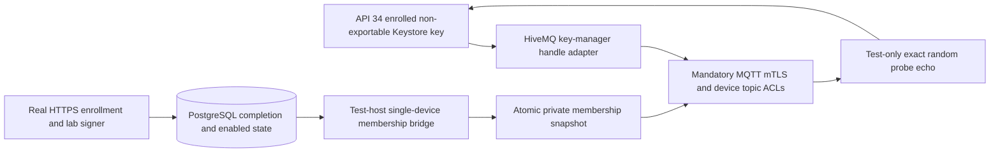

# Enrolled Android MQTT Lab

The [combined replay](../artifacts/android-backend-mqtt/20261017T093610.172037Z/replay.html) verifies API 34 Android enrollment, real Keystore MQTT mTLS and propagation of committed database disable through an opt-in test-only membership bridge. The [manifest](../artifacts/android-backend-mqtt/20261017T093610.172037Z/manifest.json) records 25 JVM tests, APK build/lint, one instrumentation scenario, and clean PostgreSQL/MQTT shutdown. This extends the separate [HTTPS identity](device-mtls.md) and [broker authentication](mqtt-device-lab.md) labs; it is not production transport or durable synchronization.



## Client Boundary

[DeviceMqttTransport](../android/agent/src/main/java/dev/fleet/agent/DeviceMqttTransport.kt) derives its host from the original HTTPS enrollment authority and accepts an explicitly supplied lab port. It uses the enrolled UUID as client ID, a pinned server root and the existing `DeviceTlsIdentity` key manager. A fixed `KeyManagerFactory` adapter supplies the original Keystore handle directly to HiveMQ; it cannot be reinitialized and does not export the key or copy it into another key store. It installs no username/password, reconnect policy or background service. The instrumentation connects using a clean session and bounded waits. Scheduling, persistent offline work, release delivery and automatic recovery are not implemented here.

Three JVM checks cover immutable key-manager wiring, authority/port/client-ID/TLS configuration and actual HiveMQ TLS using a key-handle surrogate whose encoding accessor throws. The actual TLS test verifies the presented certificate and hostname-mismatch rejection before MQTT CONNECT traffic. This software surrogate alone is not Android Keystore evidence; the separate API 34 run provides that proof. Existing SHA256-only enrollment keys remain incompatible with native prehashed TLS and fail closed without replacement; see the [digest authorization boundary](device-mtls.md#android-boundary).

## Test-Only Membership Bridge

`FLEET_TEST_MQTT_DIRECTORY` opts the test-only enrollment host into a fresh, caller-created private directory. It writes ephemeral server certificate/key and device-root PEM files with owner-only file permissions on Unix. Those files are outside retained evidence. New lab certificates include subject/authority key identifiers for Python's strict TLS chain verification; existing ledger results still recover unchanged, without replacement or reissuance.

After successful enrollment completion, the bridge reads the exact persisted response and current disabled state from PostgreSQL, then atomically replaces a one-device membership snapshot. After the existing identity diagnostic commits `DeviceAccessDisabled`, it synchronizes the disabled snapshot before returning. The broker rereads membership on subsequent authorization checks. This is deliberately a single-enrollment harness: no polling service, transactionally coupled outbox, restart recovery, multi-device synchronization, production lifecycle endpoint or audited re-enable workflow is supplied. A failure between database commit and snapshot publication can leave stale broker membership; production use requires a separately designed fail-closed synchronization boundary.

The temporary broker requires the enrolled client certificate and echoes only one exact random probe payload through its in-process test hook. It records the TLS leaf fingerprint independently, its roundtrip count, cross-device and wildcard denials, disabled subscription denial and disabled reconnect rejection. The runner compares that fingerprint to the issued enrollment certificate and requires every proof. MQTT QoS acknowledgements are not application ingestion acknowledgements, and probe bytes are not validated command/event envelopes.

## Run And Evidence

Use only an explicitly authorized, already ready disposable emulator with Device Owner retained. The runner does not provision, reset or wipe it. Install both requirement sets when running all Python tooling tests:

```sh
.lab-private/mqtt-venv/bin/python -m pip install -r tools/mqtt-lab-requirements.txt -r tools/contracts-requirements.txt
JAVA_HOME=$(/usr/libexec/java_home -v 17) .lab-private/mqtt-venv/bin/python \
  tools/check_android_backend.py --serial emulator-5554 --expected-avd Pixel_8 --with-mqtt
```

Without `--with-mqtt`, the prior HTTPS-only runner remains available. MQTT mode retains evidence separately under `artifacts/android-backend-mqtt`. Public configuration contains only roots, namespace, endpoint/pending ID, port and random public probe; the bootstrap secret remains in private pipes and app-private staging, not retained configuration or arguments. The normal enrolled identity is untouched: instrumentation uses random temporary aliases and cleans its aliases/journal. The runner removes private MQTT credentials after child termination; secure erasure and hard-crash cleanup are not guaranteed.

The [independent broker proof](../artifacts/android-backend-mqtt/20261017T093610.172037Z/mqtt-verification.json) records one exact roundtrip and one each of cross-device denial, wildcard denial, disabled subscription denial and disabled reconnect rejection. The host separately verifies one issuance/audit/completion, exact enrollment retry, key possession, HTTPS mTLS and committed disable. The [initial failed run](../artifacts/android-backend-mqtt/20261017T092823.274327Z/replay.html) stopped at `adb: device offline` before any JVM or MQTT execution. It remains failed. One clean, non-wiping restart of the matched Pixel_8 AVD restored readiness; no cause for the stalled boot was established.

Regressions passed [149 backend tests](../artifacts/backend/20261017T092849.180885Z/replay.html), [14 PostgreSQL tests](../artifacts/postgres/20261017T093039.047238Z/replay.html) with controlled restart/clean shutdown, [14 broker/probe checks](../artifacts/mqtt-device/20261017T093926.685644Z/replay.html), and 68 Python tooling tests. Hosted CI covers JVM/build/lint, host compilation, evidence validation and broker loopback tests, not this emulator/PostgreSQL scenario. The preceding broker commit `441b571` passed all three hosted jobs in [39019839922](https://github.com/michaelnwanna/custom-android-mdm-agent/actions/runs/39019839922).

Disable blocks subsequent checks and reconnect, not immediate TLS-session termination, cancellation of authorized in-flight messages or CRL/OCSP. No UI action, persistent MQTT service, live IdP, production broker membership service, authenticated backend publisher/ingester, durable Room inbox/outbox, HTTPS reconciliation, real device reboot/process recovery, power-loss behavior or current-stable Android is established by this run.