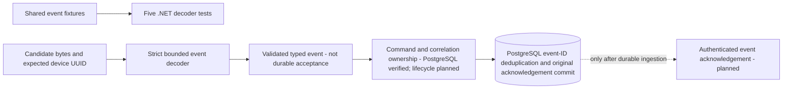

# Backend Command Event Decoding

Follow-up: the [durable PostgreSQL library](backend-event-ingestion.md) now calls this parser, checks trusted command/correlation ownership and commits event-ID deduplication with recoverable original acknowledgements. The parser-only evidence below retains its original scope; HTTP/MQTT ingestion and acknowledgement delivery remain planned. Timestamp text remains significant in the new fail-closed duplicate identity policy, not proof of distinct execution.

[CommandStateEvent.Parse](../backend/src/FleetManagement/Messaging/CommandStateEvent.cs) is a stateless .NET consumer of the [command-state event v1 contract](../contracts/events/command-event-v1.schema.json). It takes bounded JSON bytes and a device UUID supplied by a future authenticated caller, and returns typed identifiers, one of five states, a validated timestamp string and an optional error code. It is not connected to HTTP, MQTT, PostgreSQL ingestion or Android outbox acknowledgement.



## Receiver Boundary

- Nonempty input is limited to 8192 bytes, including whitespace, and JSON depth is bounded. The parser rejects unknown/duplicate fields, missing fields, null/wrong token types, comments, trailing commas/documents and malformed JSON. Both the envelope and nested error object are checked explicitly with case-sensitive property names. Parser failures produce a generic `ArgumentException`, and the parsed record's `ToString` is redacted; callers must still avoid logging raw bodies or explicitly accessed field values.
- Version must be numerically exactly 1. Integral forms such as `1.0`, `1e0` and `10e-1` are accepted without floating-point rounding; near-one decimal values, booleans, quoted values and other versions are rejected. This is numeric value validation, not a string comparison with the literal `1`.
- Event, command, device and correlation IDs must be full hyphenated UUID strings, without braces or whitespace. Uppercase hex normalizes through `Guid`. The event's device UUID must match the supplied expected device UUID. This comparison does not authenticate a sender: the future transport must derive that argument from validated credentials, not message content. UUID syntax alone does not prove uniqueness or ownership.
- Accepted states are exactly `received`, `running`, `succeeded`, `failed` and `expired`. Only `failed` requires an error object, containing only `code`. Its value is 1 through 64 ASCII characters, begins with `A` through `Z`, and otherwise contains uppercase letters, digits or underscores. Other states forbid the entire error property, including null. No freeform diagnostic detail is accepted.
- `recordedAt` requires a valid calendar date, explicit RFC 3339 timezone and valid clock/offset fields. Lowercase `t`/`z`, numeric offsets and up to nine fractional digits are accepted. Leap seconds, year zero/expanded years and greater fractional precision are rejected. These are explicit receiver restrictions beyond the schema's general date-time shape. Calendar validation uses `DateOnly`; the original timestamp string is preserved rather than rounded to .NET's 100-nanosecond `DateTimeOffset` precision. The value is not normalized for equality, ordering or storage. A later persistence/deduplication layer must define timestamp normalization and retain any required sub-tick precision; it must not compare raw timestamp spellings as proof of different events.

There is deliberately no current-clock/skew check, command lookup, correlation binding, transition ordering, replay ledger, acknowledgement generation or database write. A schema-valid `succeeded` event does not prove a command was assigned or executed. Historical fixtures remain valid parser data regardless of the current date. Server `receivedAt` belongs to a future durable ingestion record/acknowledgement, not this device event.

## Verified Evidence

The [final replay](../artifacts/backend/20261017T113652.093384Z/replay.html) and [manifest](../artifacts/backend/20261017T113652.093384Z/manifest.json) pass 154 backend component tests, including five new event-decoder tests, PostgreSQL test-project compilation and ten runner/installer unit checks. The new tests expand the original five valid event fixtures and eleven rejection mutations. They additionally check malformed/duplicate fields, every missing envelope field, device mismatch, exact version arithmetic, UUID whitespace/braces/casing, timestamp calendar/offset/precision limits, bounded failure codes and body-size boundaries. All 69 Python tooling tests pass. No PostgreSQL server, broker or emulator runtime was started for this parser-only milestone; earlier [MQTT-to-Room evidence](android-mqtt-enrollment.md#durable-receipt-follow-up) remains separate.

The [initial failed snapshot](../artifacts/backend/20261017T113141.272963Z/replay.html) failed in three mocked runner tests before .NET test execution: their minimal temporary repository lacked newly required shared contract files. The mock setup now copies those original inputs too. That failure is retained unchanged. The [intermediate passing snapshot](../artifacts/backend/20261017T113454.124152Z/replay.html) precedes the final UUID whitespace check; it is not the current-source proof.

The test project copies [the shared fixture](../contracts/fixtures/command-events-v1.json) into its output rather than maintaining forked examples. The backend evidence runner now snapshots and hashes both that fixture and its schema alongside source, resolved dependencies, command output and TRX results. Existing Android combined snapshots already retain these same event inputs. The previous MQTT-to-Room commit `af4d869` passed all three jobs in [39028170140](https://github.com/michaelnwanna/custom-android-mdm-agent/actions/runs/39028170140); that run predates this decoder. Hosted CI uses the same backend snapshot command, but a local pass is not a hosted result.

From the repository root:

```sh
cd backend
dotnet test tests/FleetManagement.Tests/FleetManagement.Tests.csproj \
  --filter FullyQualifiedName~CommandStateEventTests --verbosity minimal
```

From the repository root, `python3 tools/check_backend.py` records the full snapshot using the pinned .NET SDK. The implementation introduces no additional package: it uses `System.Text.Json`, bounded exact-number normalization, `Guid`, `DateOnly` and non-backtracking regular expressions. Durable ingestion and original-ack recovery after duplicate event delivery remain the next backend boundary; Android outbox deletion must wait for authenticated matching durable acknowledgement.