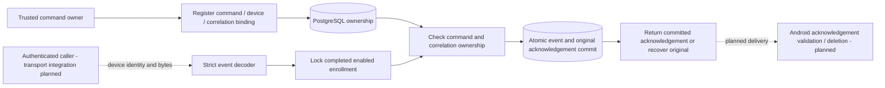

# Durable Backend Event Ingestion

Follow-up: [certificate-authenticated HTTPS ingestion](command-event-http.md) now calls this library and delivers the original acknowledgement JSON. The library-only evidence and exclusions below describe the earlier milestone; Android upload/acknowledgement validation/deletion and MQTT ingestion remain planned. Known ownership/enrollment/event conflicts now use `CommandEventRejectedException` (an `InvalidOperationException` subtype), allowing the HTTP boundary to distinguish domain rejection from unexpected failures without exposing details.

[PostgresCommandEvents](../backend/src/FleetManagement/Messaging/PostgresCommandEvents.cs) adds trusted command ownership registration and durable command-state event ingestion to the core library. Apply all six migrations, including [CommandEventIngestion](../backend/src/FleetManagement/Persistence/Migrations/20261017114417_CommandEventIngestion.cs). There is no HTTP endpoint, MQTT worker or acknowledgement delivery in this milestone.

## Trust And Transactions

`RegisterOwnershipAsync` is a trusted library operation, not an administrator-facing command creation API. It binds a nonempty command/device/correlation triple to the current completed, enabled enrollment. An identical registration is idempotent; changing a binding fails. There is no command payload, sequence allocation, actor authorization/audit or transactional command-publication outbox here. Future command creation must establish those requirements rather than trusting a device to register its own command.

`IngestAsync` requires a device UUID derived by its caller from authenticated credentials, never from the submitted body alone. The [decoder](backend-command-events.md) validates the bounded event and expected-device binding. In a read-committed transaction, ingestion then locks the enrollment row with `FOR UPDATE`, requires completed/enabled state, and checks the stored command/device/correlation/enrollment ownership. Disabled devices cannot obtain even an existing acknowledgement through this method. The row lock serializes operations per device; no transaction spans network I/O.

`StoredCommandEvents` has a global event-ID primary key and a restrictive composite foreign key to command/device/correlation ownership. The event's typed content and generated v1 acknowledgement JSON are stored in the same row. A successful method return follows commit, not merely `SaveChanges`. An identical retry returns the exact original acknowledgement JSON, including original server `receivedAt`; changed content under an existing event ID fails without replacement. A database error or cancellation does not return a receipt. As with any database client, an ambiguous commit or lost reply requires retry; transport-level error mapping remains future work.

Duplicate identity uses a private typed JSON serialization, not raw wire-byte equality: UUID casing, JSON property order and numerically equivalent version forms normalize through decoding. State/error and timestamp text remain significant. The validated timestamp string preserves up to nine fractional digits. Equivalent instants with different timestamp spellings deliberately fail closed as an event-ID conflict; this does not prove different execution, and callers must retry the original event rather than rewrite its timestamp. Semantic instant normalization is deferred. The private stored content format is not the event v1 wire serializer.

The database and ownership-registration caller are trusted. The enrollment foreign key does not independently prove that an arbitrary SQL-written ownership device matches its enrollment; the library binds and checks them. These tables are not tamper-evident storage or an adversarial-database security boundary.

## Verified Evidence

The [final PostgreSQL replay](../artifacts/postgres/20261017T115412.755332Z/replay.html) and [nested manifest](../artifacts/postgres/20261017T115412.755332Z/backend/manifest.json) pass 15 integration tests. The new ingestion scenario verifies ownership rejection/idempotence, authenticated device/correlation binding, eight concurrent identical deliveries producing one original and seven duplicates, exact acknowledgement fields, context recreation, numeric normalization, conflicting content, forced insert rollback/retry, global event-ID conflict, cancellation, composite-FK enforcement and disabled retries. The existing restart scenario now recovers the byte-identical original acknowledgement after an actual PostgreSQL fast restart. This is not a power-loss test.

The private PostgreSQL 17.11 lab uses a mode-0700 Unix socket without TCP, with fsync and synchronous commit enabled. It leaves zero test schemas and stops its server. The [final component replay](../artifacts/backend/20261017T115324.076747Z/replay.html) passes 154 tests and ten runner checks, including migration SQL/model assertions and PostgreSQL project compilation. All 69 Python tooling tests pass, and EF reports no pending model changes. No emulator or broker runtime was rerun.

The [first database run](../artifacts/postgres/20261017T114549.253014Z/replay.html) passes 15 tests but predates the new event restart assertions. The [second database run](../artifacts/postgres/20261017T115026.732916Z/replay.html) includes them but predates the migration-count test correction. Both are retained as intermediate evidence. The [failed component snapshot](../artifacts/backend/20261017T115142.287739Z/replay.html) remains failed: 153 passed and one expected five migrations while the model correctly had six. The final snapshot requires six and checks both new tables and their composite foreign key.

## Remaining Boundary

The library records validated owned event history, not a command lifecycle projection: sequence/supersession, legal transition ordering, device clock-skew policy and execution verification remain open. No public command creation, backend publisher/ingester transport, acknowledgement authentication/delivery, Android event publication/deletion, retention policy, full audit, production deployment, load acceptance or end-to-end offline recovery is established. An MQTT PUBACK remains unrelated to this durable application acknowledgement. Hosted CI compiles the PostgreSQL tests but does not run the database lab; see [CI boundaries](foundation-ci.md).