# Command Event HTTPS Ingestion

`POST /api/v1/device/command-events` accepts one command-state event under the existing [device certificate policy](device-mtls.md). The [endpoint](../backend/src/FleetManagement.Api/CommandEventEndpoints.cs) delegates to [durable PostgreSQL ingestion](backend-event-ingestion.md) and returns the stored acknowledgement JSON unchanged, only after the ingestion operation commits. This is an HTTPS lab path, not MQTT ingestion or an Android publisher.

```mermaid
flowchart LR
    Client[Enrolled client certificate - software-key TLS lab verified] --> TLS[Pinned CA / TLS key proof]
    TLS --> Identity[Exact completed certificate membership / fresh enabled check]
    Identity --> Bound[Strict event / authenticated device binding / 8192-byte limit]
    Bound --> Owned[Locked enabled enrollment and trusted command ownership]
    Owned --> Commit[(Commit event and original acknowledgement)]
    Commit --> Reply[200 with exact original event-ack v1 JSON]
    Reply -. Android integration planned .-> Outbox[Authenticate response / match device and event before deletion]
```

## HTTP Boundary

Use HTTPS with a client certificate whose private key is held by the caller. The server checks its configured device CA, client usage, device URI, exact completed certificate/key membership and current enabled enrollment. Neither a bootstrap/API bearer token nor a forwarded certificate header supplies device authentication. Invalid chains can fail before HTTP; missing/unregistered/disabled identities normally receive 401. Server certificate/hostname verification is the client's responsibility and must not be bypassed.

The request is one unencoded `application/json` event with no charset parameter or UTF-8 charset only. All bytes, including whitespace, count toward the 8192-byte limit, even without `Content-Length`. Existing strict event rules reject unknown/duplicate fields and mismatched device IDs. Body reading and ingestion share a cooperative fifteen-second deadline, separate from the authentication deadline. Requests share the identity route's process-local budget of 120 per minute, including unauthorized requests. These are lab abuse controls, not distributed limits or a guarantee that uncooperative dependencies stop immediately.

| Status | Meaning |
| --- | --- |
| 200 | First commit or identical retry; exact original acknowledgement JSON, including original server `receivedAt`. |
| 400 | Non-HTTPS request or malformed/device-mismatched event. |
| 401 / 403 | Device authentication or authorization denied. No bootstrap bearer challenge. |
| 409 | Generic command/correlation/event identity or locked enrollment rejection. Disable committed between authentication and ingestion can take this path rather than 401. |
| 413 / 415 | Body too large or unsupported media type/encoding. |
| 429 | Shared device budget exhausted; `Retry-After` supplied. |
| 500 / 503 | Generic internal/unavailable result; unavailable service, I/O and ingestion deadline use 503 with `Retry-After`. Database update failures can surface as generic 500. |

Responses are `Cache-Control: no-store`. The server returns the original JSON as JSON text rather than serializing it as a JSON string or regenerating its timestamp. Generic problems reveal no submitted body, existing event or command details. A dedicated `CommandEventRejectedException` maps known domain rejection to 409; unrelated `InvalidOperationException` remains a server failure. The ingestion interface exposes no ownership registration. Trusted command creation/registration is still internal and has no public route.

Configure the existing complete private [enrollment host settings](enrollment-http.md); this registers `ICommandEventIngestion` with `PostgresCommandEvents` and the same database factory/clock. Apply all six migrations externally; startup does not migrate automatically. Missing configuration fails closed. The [OpenAPI operation](../contracts/openapi.json) references the existing event and acknowledgement schemas, without changing their wire versions.

## Verified Evidence

The [final component replay](../artifacts/backend/20261017T125825.267077Z/replay.html) passes 158 tests and ten runner checks. Four HTTP tests verify certificate-only authorization against injected membership, response waiting for asynchronous ingestion, exact original/duplicate JSON, body/media/encoding/device boundaries, generic error redaction, unavailable service, shared rate budget and actual fifteen-second deadline expiry. TestServer injection is not itself TLS proof.

The [final PostgreSQL replay](../artifacts/postgres/20261017T125927.057447Z/replay.html) passes 15 integration tests. Its extended ingestion scenario uses actual loopback Kestrel TLS, software-key enrolled certificates, real certificate membership and PostgreSQL: anonymous denial, exact duplicate acknowledgement delivery, unowned command rejection, forced insert rollback without an acknowledgement, successful retry matching the committed row, and 401 after persisted disable. Earlier library concurrency, constraints and actual database restart recovery remain covered. This lab uses a private mode-0700 no-TCP PostgreSQL socket, fsync/synchronous commit enabled, zero remaining test schemas and clean shutdown.

The [contract replay](../artifacts/contracts/20261017T125921.868281Z/replay.html) passes ten checks, including the new operation's security, schema references, no-store response and declared statuses. All 70 Python tooling tests pass. No emulator or Android identity was changed, and no MQTT runtime was rerun.

The [first TLS/database snapshot](../artifacts/postgres/20261017T124803.380853Z/replay.html) remains failed with 14 passes/one TLS `NotTimeValid` failure. The fixture advanced its application clock before issuing the server certificate, putting validity in the host's future. The correction issues server certificates using host time and initializes the application clock at host time; trust, hostname and validity checks remain enforced. The [first corrected pass](../artifacts/postgres/20261017T124933.671675Z/replay.html) predates final component/contract test additions and remains intermediate evidence.

## Limits And Next Boundary

No Android event-upload client, acknowledgement parser/authentication or Room deletion is implemented. An HTTP error, TLS failure, MQTT PUBACK or timeout must never cause outbox deletion. A commit can succeed while its response is lost: retry the original event and verify a trusted response's exact device/event binding. Response loss and Android crash recovery are not established by these server tests. MQTT workers, production command creation/outbox, legal lifecycle projection, release execution, retention, full audit, distributed controls, production CA/revocation and full offline fleet acceptance remain open. Hosted CI compiles but does not execute the PostgreSQL/TLS runtime lab.