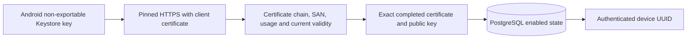

# Device HTTPS Identity Lab

Follow-up: a separate [host-side MQTT mTLS/ACL lab](mqtt-device-lab.md) verifies software-key clients and explicit local certificate membership. It does not yet use this Android Keystore identity or PostgreSQL enabled state; MQTT integration and lifecycle limits below remain open for the combined system.

The API implements `GET /api/v1/device/identity` using a separate device-certificate authentication scheme. Android uses its existing enrolled Keystore key, not a bootstrap token, to authenticate the TLS connection. This is a read-only identity diagnostic, not command delivery, MQTT authentication or full fleet management.



## Server Boundary

The existing complete `Enrollment` host configuration also configures HTTPS client-certificate trust using the enrollment CA. All five EF migrations, including `DeviceAccessControl`, must be applied out of band before serving traffic; startup never migrates a production database automatically. Kestrel requests an optional client certificate because bootstrap and administrator routes must remain accessible without one. The device endpoint requires the device scheme; neither administrator JWTs nor bootstrap tokens grant it access, and a device certificate does not grant administrator access.

TLS validates against the explicit device root with certificate downloads and revocation-network checks disabled. Certificate proof enforces P-256, ECDSA/SHA256, non-CA leaf, digitalSignature-only KU, clientAuth-only EKU, exactly one canonical `urn:fleet:device:<uuid>` SAN, current validity and at most two days' lifetime. Authentication then reads the enrollment from PostgreSQL, requires its exact completed certificate DER and public key, and rejects `DeviceAccessDisabled`. A CA signature alone is insufficient. Subject CN, URL/header device IDs and forwarded certificate headers are not identity authorities. TLS key possession is not hardware attestation or proof of non-exportability on an arbitrary client.

Responses are bounded version-1 JSON with only `schemaVersion` and the authenticated `deviceId`, plus `Cache-Control: no-store`. Missing, unregistered or disabled identities receive generic 401; invalid TLS certificates may fail before HTTP. Database failures are generic 503, unexpected faults are generic 500. A shared process-local budget allows 120 requests/minute, including unauthorized HTTP requests, with no queue. The authentication database operation has a ten-second cooperative deadline. Distributed admission, TLS handshake resource controls and abuse isolation remain deployment work.

`PendingEnrollment.DisableDeviceAccess()` is a one-way domain operation, persisted through EF. There is no public disable, re-enable, listing or recovery route yet; an authorized lifecycle/audit workflow is still needed. The test-only host disables only its isolated enrollment. Each new HTTP request checks the database with no positive identity cache, including on reused TLS connections. A request already authorized when disable commits may finish. This does not terminate a TLS socket, cancel in-flight operations, implement CRL/OCSP or disconnect broker sessions. Disabled enrollment response recovery still follows the original bootstrap rules but cannot grant device API access. Never describe this as complete revocation.

TLS must terminate directly at the configured Kestrel listener for this lab. No proxy certificate forwarding middleware is installed. A reverse proxy deployment requires a separately secured and tested boundary, not acceptance of `X-ARR-ClientCert` or similar untrusted headers.

## Android Boundary

After lab enrollment, the Device Owner diagnostic **Check enrolled HTTPS identity** uses the original journal-bound HTTPS authority, the fixed `/api/v1/device/identity` path and the independently staged server/device roots. It runs off the main thread and does not send a bearer token. The Keystore private-key handle is passed to an `X509ExtendedKeyManager`; it is never exported into a software key store. The client offers only its enrolled EC identity to compatible issuer requests, never as a server key. Default hostname verification, pinned server trust, finite connect/read timeouts, no redirects and a 4096-byte response limit remain enforced. Strict decoding rejects unknown/duplicate/missing fields, wrong types, trailing documents and a different returned device UUID. There is no automatic reconciliation scheduler or total wall-clock deadline yet.

Android Conscrypt uses `NONEwithECDSA` when TLS supplies an already hashed handshake. New P-256 keys therefore authorize both `DIGEST_SHA256` for CSRs/application signatures and `DIGEST_NONE` for TLS. TLS still negotiates its hash, and CSR/certificate policy remains SHA256; this does not export the key or implement cryptography manually. Only trusted app code can use this additional signing capability. Existing keys created with SHA256-only authorization cannot be retroactively changed. `tlsIdentity` detects that limitation and fails without replacing the key or CSR. No reset, rotation or authorized re-enrollment workflow is supplied; do not delete existing identities as a retry mechanism. The lab action is implemented but its button flow is not separately UI-acceptance-tested.

## Verification

Final follow-up: the [final replay](../artifacts/android-backend/20261017T082937.608253Z/replay.html) and [manifest](../artifacts/android-backend/20261017T082937.608253Z/manifest.json) repeat the complete scenario using the final executable inputs and expanded negative tests. The retained backend/contract/PostgreSQL regressions and exact counts are linked from [recorded tests](test-evidence.md#device-https-mtls).

The [first successful combined mTLS run](../artifacts/android-backend/20261017T081349.911626Z/replay.html) records 22 JVM tests, build/lint and one API 34 instrumentation scenario. It enrolls a random isolated identity over actual Kestrel HTTPS/PostgreSQL, authenticates with the real Keystore key, persists the disable flag and rejects the next request. The host also rejects a different CA-signed certificate for the same key/device and a forwarded-certificate header without TLS credentials. It independently verifies CSR/certificate/signature, one audit, one completed response and one issuance, then cleans its schema and stops PostgreSQL. It does not use or reset the normal device identity. Native TLS diagnostics retain only fixed labels and allowlisted exception type/numeric codes, never exception messages or private host input.

Earlier failed snapshots remain failed under `artifacts/android-backend`: the Keystore `INCOMPATIBLE_DIGEST` problem was resolved by the explicit new-key authorization above. A separate Java 21 Gradle daemon crash is not mTLS execution or a passing test; final reruns use Java 17, matching CI. The full runner is invoked from the repository root against an already ready, explicitly authorized disposable emulator:

```sh
JAVA_HOME=$(/usr/libexec/java_home -v 17) python3 tools/check_android_backend.py --serial emulator-5554 --expected-avd Pixel_8
```

This establishes HTTPS mTLS only on the recorded API 34 lab. MQTT mTLS/ACLs and session disconnects, live OIDC, production secure bootstrap delivery, UI acceptance, current-stable Android, real reboot/process recovery, power loss, production CA/key management and audited lifecycle operations remain unverified or unimplemented. See [Android enrollment](android-enrollment.md) for secret staging, cleanup and filesystem limits.