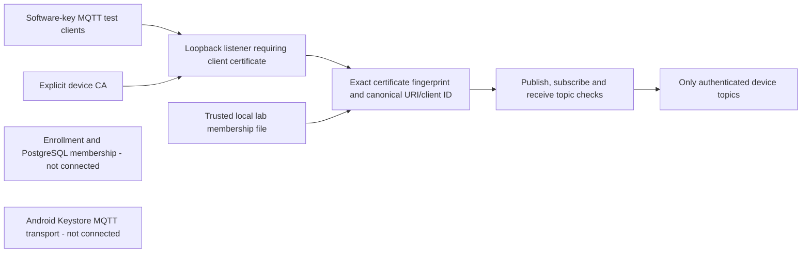

# Device MQTT Authentication Lab

The separate [device broker](../tools/mqtt_device_broker.py) implements loopback MQTT 3.1.1 mTLS with explicit certificate membership and directional device-topic ACLs. The [final replay](../artifacts/mqtt-device/20261017T090429.856572Z/replay.html) records thirteen passing policy/plugin and real TLS tests. This is an isolated host-side transport boundary, not Android enrollment-to-MQTT integration or production fleet infrastructure. The existing anonymous [Android probe broker](../tools/mqtt_lab.py) and its historical API 34 results are unchanged.



## Identity And Topics

The listener binds only `127.0.0.1` and defaults to port 8884, leaving the earlier anonymous diagnostic on 8883 alone. TLS 1.2 or newer and a client certificate are mandatory. The configured device CA is the TLS trust authority; no system client-root fallback or plaintext listener is supplied. Server and device roots can be distinct, as they are in the wire tests. Clients must pin and verify the server independently.

After successful TLS verification, the plugin requires an exact enabled leaf-certificate SHA256 fingerprint from the lab membership file. A CA signature alone does not grant access. It additionally checks P-256, ECDSA/SHA256 certificate signature algorithm, non-CA leaf, digitalSignature-only KU, clientAuth-only EKU, current validity and at most two days' validity. The single SAN must be exactly `urn:fleet:device:<canonical-nonzero-uuid>`, and the MQTT client ID must equal that UUID. Certificate subjects and MQTT username/password do not establish identity. Connections carrying username/password, a last will or a persistent-session request are rejected.

For authenticated device UUID `D`, the complete allowlist is:

| Action | Allowed Topic |
| --- | --- |
| Publish | `fleet/devices/D/command-events` |
| Subscribe and receive | `fleet/devices/D/commands` |
| Subscribe and receive | `fleet/devices/D/event-acks` |

Other device IDs, `+`/`#`, shared subscriptions, system topics, suffixes and wrong-direction topics are denied. The topics reserve a lab routing convention for the existing [message contracts](../contracts/README.md); payload JSON, envelope `deviceId` and command/event lifecycle are not validated or processed by this broker. No external management/publisher identity is implemented. Test-only in-process broadcasts exercise downlink isolation and are not an administrative network credential.

MQTT QoS acknowledgement can precede application authorization in aMQTT. A publish acknowledgement is not proof that an event was accepted, persisted or applied. Disallowed publishes are dropped before broadcast; unauthorized subscriptions receive failure code 128. Retained storage/replay is disabled, only clean sessions are accepted, and there is no offline queue, persistence plugin or recovery guarantee.

## Membership Configuration

The caller supplies the server certificate/key, device CA and a trusted local JSON file. No credentials are auto-created, inferred from enrollment, logged or placed in evidence by the server. Keep private keys and the membership file in an owner-controlled local directory outside Git; changing membership is a trusted lab operation, not an audited fleet lifecycle API.

```json
{
  "schemaVersion": 1,
  "devices": {
    "11111111-1111-4111-8111-111111111111": {
      "certificateSha256": "<replace-with-64-lowercase-hex-SHA256-of-issued-leaf-DER>",
      "enabled": true
    }
  }
}
```

Replace the example UUID and fingerprint with the actual issued identity; the placeholder intentionally fails validation. The digest is over the DER leaf, not PEM text, a root, public key or the whole chain. Documents reject duplicate/unknown fields, non-boolean enabled state, noncanonical identities and fingerprints, more than 128 members or more than 65536 bytes. Missing, invalid or unreadable membership fails closed.

Membership is reread at CONNECT and each publish/subscribe/receive authorization, with no positive cache. Publish changes by atomic same-directory replacement to avoid partial reads; a partial file denies access rather than retaining old permissions. Set `enabled` to false to deny subsequent checks and reconnect. A socket is not forcibly disconnected, and a message already authorized or queued for delivery may finish. There is no CRL/OCSP, broker-session termination, audited disable/re-enable workflow or backend state propagation. File reads are synchronous and assume a trusted responsive local filesystem.

```sh
.lab-private/mqtt-venv/bin/python -m pip install -r tools/mqtt-lab-requirements.txt
.lab-private/mqtt-venv/bin/python tools/check_mqtt_device.py
.lab-private/mqtt-venv/bin/python tools/mqtt_device_broker.py \
  --server-certificate .lab-private/mqtt-device/server.pem \
  --server-key .lab-private/mqtt-device/server-key.pem \
  --device-root .lab-private/mqtt-device/device-root.pem \
  --memberships .lab-private/mqtt-device/members.json
```

The serve command requires caller-provisioned files; the verification command is self-contained. It creates separate ephemeral roots and software device keys in a temporary directory, starts ephemeral loopback ports and shuts down the test brokers. It neither starts nor changes an emulator, production database, normal enrolled device identity or the old probe broker. Temporary keys are excluded from snapshots and removed on normal cleanup; hard-crash cleanup and secure deletion are not guaranteed.

## Verification And Limits

The [runner](../tools/check_mqtt_device.py) copies exact executable/test inputs, executes against those copies, and retains dependency versions, structured counters, command output, result/source hashes and HTML. The [final manifest](../artifacts/mqtt-device/20261017T090429.856572Z/manifest.json) records thirteen tests without failures, errors or skips. Seven policy/plugin tests cover certificate membership/profile, exact topics, invalid/missing registry, fresh enabled state and unsafe session options. Six wire tests cover mandatory mTLS with distinct roots, alternate valid but unregistered certificate, forged client ID, wrong server trust/hostname, cross-device/wildcard denial, live publish/receive checks, disable/reconnect, persistent-session rejection and retained suppression. Negative connections must raise the MQTT library's connection error, not an arbitrary exception or test timeout. The [earlier twelve-test replay](../artifacts/mqtt-device/20261017T085730.677126Z/replay.html) predates retained-message coverage; the [first thirteen-test replay](../artifacts/mqtt-device/20261017T090141.319330Z/replay.html) predates the final hostname/error-type checks. All remain separate. The complete Python tooling suite also passed 66 tests with both contract and MQTT requirements installed.

aMQTT 0.11.3 mutates sessions by claimed client ID before its normal authentication callback. The pinned `DeviceBroker` override parses CONNECT with the library, applies a ten-second CONNECT deadline, authenticates before session cleanup and then delegates normal traffic handling. The wire regression confirms a rejected forged ID does not destroy the legitimate client's subscription. Other overrides require certificates in TLS and suppress retained storage/replay. These are deliberate version-coupled integration points; upgrading aMQTT requires rerunning and reviewing them. This is not a security audit of all aMQTT behavior.

The [foundation workflow](foundation-ci.md) has a dedicated snapshot-runner job; hosted coverage requires its actual published Actions result. Thirteen local tests do not establish Linux CI success. Production deployment needs broker selection/hardening, handshake/message resource limits, distributed admission, secure membership integration and lifecycle handling. Real enrolled Android Keystore MQTT, live PostgreSQL membership, authenticated backend publish/ingest, payload identity validation, MQTT session termination, durable Room/outbox processing, reconciliation, reconnect/process/reboot/power-loss behavior and current-stable Android remain unverified or unimplemented. The [HTTPS identity lab](device-mtls.md) retains its separate real Android/PostgreSQL proof.